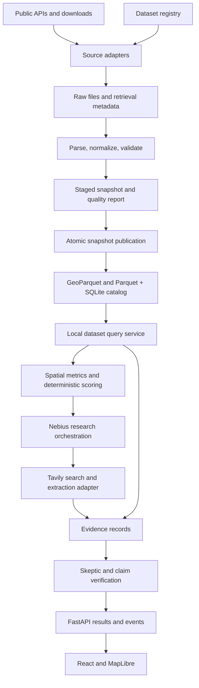

# Connector Blueprint — AI Location Intelligence

Status: implementation blueprint. The backend implements shared contracts, LOR and population adapters, bounded Berlin ALKIS parcel ingestion, snapshot storage, and read APIs. See the [backend setup guide](backend/README.md) for commands and validated source details. Other connectors and analysis/research workflows remain planned.

Design date: **18 October 2026**. Source inventory: [DATA_SOURCES.md](DATA_SOURCES.md). Project scope: [README.md](README.md).

## 1. Decisions and Scope

Build one Python backend with small source adapters and a shared ingestion pipeline. Download and normalize structured datasets before an investigation; serve analysis from local, versioned snapshots. Use Tavily for targeted web research during an investigation and Nebius for planning and reasoning.

The connectors acquire data and preserve its meaning. Spatial analysis, scoring, entity matching, and claim verification live in separate application modules. This lets us replace a provider or replay a snapshot without changing scoring logic.

- **MVP:** OSM, LOR boundaries, population, IHK businesses, VBB static GTFS, and Tavily research. Nebius is the inference gateway, not a factual data source.
- **Next:** Kindergarten locations, child-age cohorts, households, addresses, and planning layers.
- **Later:** Census grids, environmental layers, additional amenities, mobility observations, Overture, and other enrichments from the source inventory.
- **Demo default:** A prepared Berlin snapshot. Do not depend on citywide live downloads completing during a presentation.
- **Storage:** Raw files and normalized GeoParquet/Parquet on disk; SQLite for manifests, ingestion jobs, and research events. GeoPandas/Shapely perform spatial calculations. Add PostGIS only if deployment or query volume requires it.
- **Cost boundary:** Public dataset acquisition should require no paid data subscription. Tavily, Nebius, storage, and hosting have separate budgets; free datasets do not imply free inference or research calls.

## 2. Architecture and Data Flow



Dependency rule: domain records and application interfaces must not import concrete HTTP clients, provider SDKs, FastAPI, or database implementations. Provider adapters translate external formats into the shared records. The API and agent tools call application services rather than individual providers directly.

## 3. Connector Registry and Priorities

Implement reusable transport/parser families, then configure datasets within them. A shared WFS client does not imply that all layers have the same fields, quality rules, or update schedule.

| Connector / dataset ID | Adapter family | Output | Priority | Proposed update check |
|---|---|---|---|---|
| `osm_pois` | Overpass JSON; Geofabrik PBF fallback | `Place` | MVP | Daily; pin a release for the demo |
| `berlin_lor` | Geospatial file | `Area` | MVP dependency | Monthly check; ingest changed editions |
| `berlin_population` | Tabular file | `AreaObservation` | MVP | Monthly check for new published period |
| `ihk_businesses` | Tabular file | `Business` | MVP | Monthly |
| `vbb_gtfs` | GTFS ZIP | `TransitStop`, schedule tables | MVP | Daily check; ingest changed feed |
| `tavily_research` | Authenticated search/extraction API | `WebEvidence` | MVP | On demand, within research budget |
| `berlin_kitas` | Berlin WFS | `Facility` | Next | Weekly |
| `berlin_households` | Tabular file | `AreaObservation` | Next | Monthly check for new period |
| `berlin_addresses` | Berlin WFS | `Address` | Implemented | Monthly |
| `berlin_alkis_buildings` | Berlin WFS | `Building` | Next | Monthly |
| `berlin_mietspiegel_wohnlagen` | Berlin WFS | `ResidentialLocationClass` | Next | Check each Mietspiegel edition |
| `berlin_planning` | Berlin WFS, plus linked documents | `PlanningFeature`, `WebEvidence` | Next | Weekly |
| `berlin_centers` | Berlin WFS | `RetailCenter` | Next | Monthly |
| `berlin_alkis_parcels` | Berlin WFS (ALKIS) | `Parcel` | Next | Monthly |
| `berlin_population_forecast` | Tabular file | `AreaObservation` with scenario | Next | Monthly check for new edition |
| `berlin_schools`, `berlin_parks`, `berlin_hospitals` | Berlin WFS | `Facility`, `Area` | Later | Monthly |
| `berlin_social_monitoring` | Tabular/geospatial file | `AreaObservation` | Later | Monthly check for new edition |
| `berlin_environment` | Berlin WFS/geospatial file | `AreaObservation`, `Area` | Later | Monthly check for new edition |
| `zensus_grid` | Tabular/geospatial file | `GridObservation` | Later | Pin the census edition |
| `berlin_bicycle_counts`, `berlin_road_traffic` | Tabular file / WFS by dataset | `MobilityObservation` | Later | Dataset-specific; static and time-series rules differ |
| `berlin_accidents` | Tabular/geospatial file | `Incident` | Later | Annual edition check |
| `berlin_tourism` | Tabular file | `AreaObservation` | Later | Monthly |
| `overture_places` | Area-filtered GeoParquet | `Place` | Later | Release check, then pin release |
| `dwd_climate` | Station/grid file | `WeatherObservation` | Later | By selected product |
| `vbb_realtime` | GTFS-RT Protobuf | `TransitUpdate` | Optional live feature | Only while needed; respect provider policy |
| `berlin_land_values` | WMS display/reference | Map overlay and reference links | Reference only | Check selected annual edition |
| `district_studies`, housing plans, Kita-Navigator | Curated reference URLs; permitted extraction | `WebEvidence` | Research only | On demand |

These intervals are our proposed cache/update policy, not claims about publication frequency. Use the [source inventory](DATA_SOURCES.md) for provider links and licenses. Land-use and housing-plan datasets join `berlin_planning` only when their actual downloadable formats and mappings have been validated. Do not build a bulk scraper for Kita-Navigator without establishing a supported access method and reuse terms.

### Dataset Configuration

Each registry entry must define:

- `dataset_id`, `provider`, adapter family, enabled flag, and contract version.
- Official landing-page URL, resolved resource URL, permitted provider hosts, and authentication reference, if required.
- Access-validation state: `unvalidated`, `validated`, or `blocked`, with a reason and last check time.
- Source license, license URL, attribution text, and redistribution status. Unknown reuse terms block public redistribution; they are not assumed permissive.
- Expected media types, size limits, encoding, parser options, and required fields.
- Source CRS, spatial extent, geographic hierarchy/version, and field/category mappings.
- Available reference periods, freshness policy, timeout, concurrency, and retry limits.
- Completeness checks, rejection thresholds, and whether the source is required for a use case.

Keep resolved file URLs and WFS layer names in reviewed configuration. Do not invent them from dataset titles or let an LLM silently select a replacement file after an endpoint changes.

## 4. Shared Contracts

### 4.1 Normalized Records

Use typed domain records; use Pydantic at JSON/API boundaries. Every record carries `schema_version`, `source_id`, `snapshot_id`, `source_record_id`, `record_id`, and `quality_flags`.

`record_id` is unique within a snapshot and record type. Preserve a provider's stable ID where available. If none exists, derive a deterministic ID from documented natural keys; do not promise cross-edition identity when a provider does not supply it.

| Record | Required domain fields | Important semantics |
|---|---|---|
| `Place` | Geometry, canonical category, original category, optional name | Include category-mapping version; unmapped categories remain explicit |
| `Business` | Coordinates, industry code and code system, optional employee range, business age, supplied LOR code | Preserve anonymous records; employee ranges are not exact headcounts |
| `Building` | WGS84 Polygon/MultiPolygon, ALKIS object type, optional cadastral function, recorded storeys, address references, provider footprint area | Cadastral function is not current use; null storeys are unknown; footprint × storeys is not usable floor area |
| `Area` | Geometry, area code, hierarchy, boundary edition, name | A planning area and a transit catchment are different spatial units |
| `Parcel` | WGS84 geometry, ALKIS UUID and cadastral identifiers, official and derived area | Keep identifiers as strings; source-provided `afl` and derived EPSG:25833 geometry area are distinct; no ownership or permission claims |
| `AreaObservation` | Area code and boundary edition, metric code, value or null, unit, reference period, value status | Preserve counts, rates, denominators, age bands, and forecast scenarios separately |
| `GridObservation` | Grid-cell identifier, grid definition/CRS, metric, reference period, value status | Suppressed cells and zero-valued cells differ |
| `Facility` | Geometry, facility type, provider ID, optional attributes | Capacity and vacancies are nullable and carry their own reference dates when present |
| `TransitStop` | Stop ID, geometry, parent station, location type | Keep platforms and station entrances distinguishable |
| `Address` | Official address components and point geometry | An address point is not proof of vacant commercial premises |
| `PlanningFeature` | Geometry, plan ID, supplied status, document references | Preserve draft/adopted/withdrawn distinctions; avoid inferred permit conclusions |
| `MobilityObservation` | Station/segment, mode, count/unit, interval, measurement/model status | Bicycle counts, road estimates, and pedestrians are not interchangeable |
| `Incident` | Source event ID, location, period, available severity/category | Describes recorded incidents, not an overall safety score |
| `WeatherObservation` | Station/cell, variable, unit, interval, value status | Preserve product resolution and distinguish observations from forecasts |
| `TransitUpdate` | Feed timestamp, affected provider identifiers, update type, payload | Resolve identifiers only against a compatible static feed |
| `WebEvidence` | Original URL, title, retrieval time, excerpt locator, query, extraction status | Retrieval is not verification; publication date may be unknown |

Use `value_status = observed | estimated | forecast | suppressed | missing | not_applicable`. Parse provider sentinel values into a null value plus the appropriate status. Retain original labels in provenance; never convert unknown values into zero.

### 4.2 Spatial and Temporal Rules

- GeoJSON and public bounding boxes use WGS84 longitude/latitude, with bbox order `[west, south, east, north]`.
- Use **EPSG:25833** for Berlin distance, buffer, and area calculations after checking the input CRS. Do not measure meters in longitude/latitude coordinates.
- Preserve polygon/multipolygon geometry. A representative point may be derived for map markers, but does not replace the source geometry.
- Store LOR codes as strings so leading zeros survive. Joins require matching hierarchy and boundary edition; name matching alone is insufficient.
- Store system timestamps in UTC. Preserve source reference dates and periods separately. Evaluate transit service in `Europe/Berlin`.
- An observation for an entire LOR cannot become a measured count inside a 500 m circle. Any spatial allocation is a derived estimate with an explicit method and uncertainty.

### 4.3 Snapshot Manifest and Provenance

Every published source snapshot has an immutable manifest containing:

| Field | Purpose |
|---|---|
| `snapshot_id`, `dataset_id`, `schema_version`, `adapter_version` | Identify the exact normalized result |
| `landing_url`, `resource_url`, `retrieved_at` | Link to the provider and actual retrieval |
| `source_edition`, `reference_period`, `valid_from`, `valid_to` | Describe the data's temporal meaning; allow unknown values |
| `raw_assets[]` | Paths, SHA-256 hashes, byte sizes, ETag/Last-Modified where supplied; one snapshot may use multiple files |
| `request_fingerprint`, `parser_config_hash` | Reproduce query scope, mappings, and parsing choices without storing secrets |
| `coverage` | Geographic extent, categories, periods, completeness, and any known omissions |
| `quality_report` | Input/output/rejected rows, duplicate IDs, invalid geometries, warnings, and validation results |
| `license_id`, `license_url`, `attribution`, `redistribution_status` | Preserve dataset-specific reuse conditions |
| `normalized_assets[]`, `parent_snapshot_ids[]` | Locate normalized partitions and record dependencies |

Define freshness separately from validity. A recently retrieved 2022 census remains a 2022 observation. A cached GTFS feed can be recently downloaded yet contain no service for the requested date.

Every computed metric records its input snapshot IDs, source-record selectors, calculation version, parameters, unit, limitations, and evidence links. The UI links to the original provider and exposes reference dates; a local file path is not the user's citation.

### 4.4 Adapter Interfaces

The following is an interface sketch, not executable implementation. Referenced types are the contracts in this document.

```python
class SnapshotConnector(Protocol):
    async def probe(self, config: DatasetConfig) -> SourceHealth: ...
    async def fetch(self, request: FetchRequest) -> RawBundle: ...
    def normalize(self, raw: RawBundle, config: DatasetConfig) -> NormalizedBatch: ...
    def validate(self, batch: NormalizedBatch) -> QualityReport: ...

class DatasetReader(Protocol):
    async def query(self, request: DatasetQuery) -> DatasetPage: ...

class ResearchConnector(Protocol):
    async def search(self, request: ResearchSearch) -> EvidencePage: ...
    async def extract(self, request: ResearchExtract) -> EvidencePage: ...
```

- `FetchRequest`: registered dataset ID, explicit source edition or resolved resource, validated extent, and ingestion budget. The runner supplies credentials through its context.
- `RawBundle`: downloaded assets and retrieval metadata, including query scope and provider errors.
- `NormalizedBatch`: typed records or partition references; stream large files instead of building one enormous JSON array.
- `DatasetQuery`: pinned snapshot ID, record type, extent/area filters, reference-period filters, category filters, page limit, and cursor. Reject unsupported filters explicitly.
- `DatasetPage`: records, coverage, warnings, availability, snapshot ID, retrieval/reference dates, and next cursor. Maximum proposed page size: 1,000 records.
- `SourceHealth`: probe result and last probe time, separate from the status of local snapshots. A failed provider probe does not make a valid cached snapshot disappear.

The ingestion runner owns locks, retries, state transitions, and publication. Adapters do not publish files or run scoring themselves. The read service queries already published snapshots and never performs hidden provider downloads.

## 5. Ingestion Lifecycle and Cache Behavior

1. **Resolve:** Load a reviewed registry entry, select a source edition, and resolve its resource. Record the resolved URL and scope. Reject an HTML landing page when a CSV or archive is expected.
2. **Acquire:** Download to a staging directory using bounded time/size limits. Respect conditional HTTP requests; a `304` reuses the prior raw asset without pretending a new observation occurred.
3. **Parse:** Validate file signatures as well as media types; stream large tables and safely unpack archives. Do not extract outside staging or expand archives without an unpacked-size limit.
4. **Normalize:** Apply explicit field/category mappings; preserve source identifiers, units, null/suppression states, and CRS. Record transformation versions.
5. **Validate:** Check schema, extent, completeness, duplicates, reference periods, and cross-table relations. Generate a quality report even when publication fails.
6. **Publish:** Write immutable normalized assets and a manifest, then atomically change the SQLite active-snapshot pointer. Serialize ingestion per dataset. A failed or interrupted import leaves the previous snapshot active.
7. **Serve:** Pin snapshot IDs at analysis start and reuse that set throughout ranking and verification. New web evidence may be appended with retrieval times. Adding a different structured snapshot creates a new analysis revision and reruns affected metrics.

Cache keys include dataset ID, source edition/response hash, query extent/categories where applicable, adapter version, mapping hash, and schema version. Derived metric caches additionally include all input snapshot IDs and metric parameters. Retain published assets while analyses reference them.

For the MVP, use an explicit ingestion CLI and a single backend instance. Persist job states `queued`, `running`, `succeeded`, `failed`, and `aborted`; mark interrupted jobs on startup. Scheduled jobs and a distributed queue are later deployment choices.

### Availability and Failures

Keep availability (`ready | partial | unavailable`), freshness (`current | stale | unknown`), and truth/verification status separate.

| Condition | Behavior |
|---|---|
| Timeout, HTTP 429, transient 5xx | Honor `Retry-After`; otherwise bounded exponential backoff with jitter, at most three attempts total |
| Authentication failure or other permanent 4xx | Stop; report configuration/access problem rather than retrying blindly |
| Schema drift or unexpected HTML | Quarantine the new import; retain last valid snapshot; require a reviewed mapping/resource update |
| WFS/Overpass truncation or incomplete pagination | Do not publish a normal complete snapshot; explicitly flag any diagnostic partial data |
| Some rows invalid | Apply dataset-specific rejection thresholds; rejected rows and reasons remain auditable |
| Provider down, valid cache available | Serve cache with retrieval/reference dates and an explicit freshness warning when needed |
| Required data absent or outside its validity period | Return unavailable for that analysis; do not manufacture a ranking |
| Optional data absent | Return missing metrics and disclose any scoring-weight redistribution |
| Successful empty query within validated coverage | Return zero records; distinguish this from missing coverage or a failed source |

Application defaults: one concurrent external request per provider, a short metadata timeout, and a separate bounded bulk-download budget. These are conservative starting settings, not provider quotas. Track latency, attempts, bytes, row counts, rejected rows, cache hits, and snapshot ages.

## 6. Source-Specific Designs

### A. OSM: Competitors and Amenities

**Access:** [Overpass documentation](https://dev.overpass-api.de/overpass-doc/en/) and [Geofabrik Berlin](https://download.geofabrik.de/europe/germany/berlin.html).

- Build bounded Overpass requests from an allowlisted category mapping, covering nodes, ways, and relations. Preserve IDs as `node/<id>`, `way/<id>`, or `relation/<id>`.
- Keep original tags and the extraction timestamp. Website, opening hours, and accessibility tags may be absent or outdated.
- Support a Geofabrik PBF import with the same category/normalization contract. Parse with an appropriate OSM reader; do not assume PBF is an ordinary vector file.
- If Overpass returns an error remark or truncated result, fail completeness checks. Do not silently combine a failed current query with part of an older extract.
- Choose one OSM snapshot per analysis. Record whether positions are source points, geometry-derived points, or centers supplied by the query.
- Keep shop/amenity categories distinct: bakeries may compete with cafés, but that is a versioned scoring/category decision.

Public servers apply shared-resource limits; cache broad extractions and follow the [Overpass usage policy](https://dev.overpass-api.de/overpass-doc/en/preface/commons.html). OSM attribution and database licensing remain attached to derived outputs.

### B. Berlin WFS: Kita, Addresses, Amenities, and Planning

**First dataset:** [Berlin kindergarten WFS listing](https://daten.berlin.de/datensaetze/kindertagesstatten-wfs-d03b94d2).

- Read `GetCapabilities`, then `DescribeFeatureType`. Record supported versions, layer names, CRS choices, output formats, and paging behavior.
- Request GeoJSON only when advertised; otherwise parse a supported GML format. WFS services need operation parameters, so a bare service URL is not a download test.
- Use `GetFeature` with the advertised filtering/paging mechanism. Check total counts where available, repeated pages, missing pages, and provider exception documents, including those returned with HTTP 200.
- Handle WFS axis order explicitly. Validate known Berlin features before trusting coordinates; GeoJSON output must be longitude/latitude.
- Every layer has its own field mapping and version. Preserve provider facility IDs and plan statuses without assuming field names before inspection.
- `berlin_alkis_buildings` reads the live ALKIS `AX_Gebaeude` WFS layer over a configured, complete bounded extent; `AX_Bauteil` parts are excluded. Preserve Polygon/MultiPolygon footprints and documented cadastral attributes, parse `namlag` only as a reference, and never zip `lag` keys to its street labels. `pnr` is a pseudonumber rather than the building's own address. Address matching may be ambiguous; unmatched nearby buildings are informational only. Parcel overlays are a synthetic-tested contract for the sibling ALKIS parcels dataset and do not imply parcel data is currently available.
- Kita capacity/vacancies remain null unless the source actually provides a dated, documented value. A facility registry supports provision analysis, not a claim that places are available.
- `berlin_addresses` normalizes the live Berlin address-point layer to WGS84, preserves provider-supplied LOR codes, and validates those links against the pinned 2021 LOR snapshot. Address points are not premises or evidence of availability.
- Use WMS only as a display/reference layer; do not derive numeric scoring data from rendered map colors.

The official [Berlin service migration notes](https://www.berlin.de/sen/sbw/_assets/stadtdaten/geoportal/aktuelles/austausch-diente-server-allgemein.pdf?ts=1691689866) show the current service URL pattern. Resolve actual endpoints through the dataset listing rather than copying obsolete FIS-Broker URLs.

#### Address-level Mietspiegel Wohnlagen (`berlin_mietspiegel_wohnlagen`)

The Berlin WFS source supplies address points and the 2026 official classes `einfach`, `mittel`, and `gut`. `ResidentialLocationClass` stores the source address key, address labels, WGS84 point, class status, edition, validity, and source provenance. The read endpoint is `GET /api/v1/datasets/berlin_mietspiegel_wohnlagen/wohnlage`; callers provide a Wohnlagen `snapshot_id` and exactly one address key, street/house-number tuple, or address-snapshot/address-id pair. Responses distinguish `matched`, `matched_unclassified`, `not_found`, `not_joinable`, and `ambiguous`. An ambiguous candidate is not selected as a class.

Address joins use the source key rule `five-digit street code + three-digit zero-padded house number + optional uppercase suffix`. The data are the official address-level classification, not a rent lookup: no rent-table values are imported, and the class must not be interpreted as income, purchasing power, commercial suitability, footfall, or shop rent. The official Mietspiegel [Wohnlagen explanation](https://mietspiegel.berlin.de/berliner-mietspiegel/erlaeuterungen-zum-mietspiegel/wohnlagen/) describes the classification. Its legally authoritative assignment is the official Straßenverzeichnis; generalized map colors are not a basis for inferring an address class. The classification is valid 2026-05-28 through 2028-05-28, and its existence for an address does not mean a particular dwelling falls within the Mietspiegel's scope. East/West is the source's former east/west rent-table marker, not a current district. Address shares are not population-weighted; edition is pinned from the service/configuration because the provider has no edition property, and raw WFS hashes can vary between downloads.

### I. ALKIS cadastral parcels

`berlin_alkis_parcels` uses the reviewed Berlin ALKIS WFS layer and a fixed 5 × 5 km EPSG:25833 candidate extent. WFS returns complete parcel geometries intersecting that extent, including edge parcels extending beyond it. The configured 5,000-feature pages, page ceiling, and cumulative byte cap keep this import bounded; do not substitute a citywide request (403,526 matched features, approximately 420 MB raw) without a streaming/tiled design.

`Parcel.source_record_id` is the ALKIS `uuid`; the display `parcel_id` is `fsko`, which can change after parcel splits or merges. Preserve cadastral codes and identifiers as strings. `official_area_m2` is the provider's `afl` (Amtliche Fläche); `geometry_area_m2` is the separately derived planar area of the source geometry in EPSG:25833. They are not interchangeable, and material differences are surfaced as quality warnings.

The parcel index supports point, bbox, and generic geometry relationships for buildings, addresses, and planning snapshots without importing their domain classes. Boundary points may match multiple parcels, buildings can intersect multiple parcels, and polygon touches with zero area are not assigned an area share. Relationship responses pin both snapshots and identify EPSG:25833 as the calculation CRS. Geometric overlap is not a legal parcel assignment. Parcel or planning records do not establish ownership, use, development permission, available premises, commercial tenancy, or an acquisition offer.

### C. LOR, Population, Households, and Forecasts

**Access:** [LOR boundaries](https://www.berlin.de/sen/stadt/stadtdaten/stadtwissen/sozialraumorientierte-planungsgrundlagen/lebensweltlich-orientierte-raeume/), [population](https://www.statistik-berlin-brandenburg.de/a-i-16-hj/), and [households](https://www.statistik-berlin-brandenburg.de/a-i-17-j/).

- Ingest boundary geometries first. Population ingestion depends on an explicitly selected compatible boundary edition.
- Configure delimiter, decimal convention, encoding, header rows, worksheet, and suppression markers per edition. Detect format changes rather than guessing silently.
- Normalize wide demographic tables into observations keyed by area, period, metric, and age band. Avoid mixing totals with their component rows or summing overlapping cohorts.
- Keep the provider's area hierarchy; do not treat Prognoseraum, Bezirksregion, and Planungsraum as interchangeable.
- Check join coverage, unique observation keys, valid age bounds, and documented totals where definitions agree. Report unmatched area codes.
- Keep forecast scenario and forecast edition distinct from actual population observations. Ratios use compatible reference periods and documented denominators.

### D. IHK: Industry and Workplace Context

**Access/schema:** [IHK Berlin repository](https://github.com/IHKBerlin/IHKBerlin_Gewerbedaten).

- Select and pin a monthly CSV. Preserve `opendata_id`, coordinates, `planungsraum_id`, industry codes/descriptions, `employees_range`, and `business_age` when available.
- Store industry code-system and mapping versions. Keep missing employee classes and unknown categories explicit.
- Treat employee classes as intervals; any midpoint-based demand estimate is a documented derived proxy. Do not present it as measured daytime population.
- Reconcile supplied LOR IDs with the selected boundary edition and report inconsistencies; do not silently overwrite source identifiers.
- OSM and IHK are complementary inventories. Report source-specific counts initially. A later matching layer may propose spatial/category matches with confidence and reversible links; never simply add both counts as unique businesses.

### E. VBB: Stops and Scheduled Accessibility

**Access:** [VBB datasets](https://unternehmen.vbb.de/digitale-services/datensaetze/). **Format:** [GTFS schedule reference](https://gtfs.org/documentation/schedule/reference/).

- Import `agency`, `stops`, `routes`, `trips`, and `stop_times`; apply `calendar` and/or `calendar_dates` as required by the feed. Retain service validity and timezone.
- Check foreign keys and distinguish stations, platforms, and entrances. Deduplicate candidate-area service counts by documented trip/station rules.
- Evaluate an explicit service date and time window, honoring exceptions and times after `24:00:00`. Handle frequency-based service if present; label estimates where schedules are not exact.
- Compute straight-line stop distance first and label it accordingly. Walking times require a separately validated pedestrian network/routing method; see §I.
- Scheduled departures measure service supply, not passenger footfall. Do not infer wheelchair access from a missing accessibility field.
- Keep GTFS-RT optional. Its failures do not invalidate the static feed or a ranking based on scheduled accessibility.

### F. Tavily: Targeted Research and Evidence

**Access:** [Tavily Search](https://docs.tavily.com/documentation/api-reference/endpoint/search) and [Extract](https://docs.tavily.com/documentation/api-reference/endpoint/extract).

- Inject `TAVILY_API_KEY` from the server environment. Record configured search depth, query, domain filters, candidate IDs, and consumed budget.
- Search for specific evidence gaps, then extract selected original URLs when useful. Preserve search snippets separately from extracted page passages.
- Inspect both `results` and `failed_results` from extraction, including HTTP-200 responses. Preserve per-URL failures and mark the batch partial when appropriate.
- Store canonical/original URL, title, retrieval time, publication date when supplied, passage locator, and extraction status. Retain only permitted content; a hash is useful for change detection but is not sufficient evidence by itself.
- A search result becomes a candidate evidence record, not a verified claim. The verifier assesses support, relevance, date, and contradictions; an unavailable page leaves an evidence gap.
- Cache identical queries within a run; for reuse across runs apply a freshness policy based on claim type. Current rents and planning changes need different freshness treatment from historical census methodology.
- Start with a configurable budget, for example five shortlisted candidates, two searches each, one contradiction round, and a separate extraction cap. These are application limits, not provider guarantees.

### G. Nebius: Inference Gateway

**Role:** Planning, tool selection, synthesis, and skeptical review. Generated model text is never registered as a public-data source.

- Configure server-side `NEBIUS_API_KEY`, `NEBIUS_MODEL`, and `NEBIUS_BASE_URL`; select a model available to the hackathon account rather than hardcoding an assumed model.
- Use an adapter exposing `plan`, `synthesize`, and `review` operations with validated structured outputs and bounded inference budgets.
- Route tool requests through application services that validate dataset IDs, extents, time windows, and budgets. The model does not receive credentials or arbitrary filesystem/network access.
- Keep raw source text as untrusted evidence. It must not change system instructions or authorize new tools.

Confirm endpoint and account capabilities against the [Nebius API documentation](https://docs.tokenfactory.nebius.com/api-reference/introduction) before implementation.

### H. Later Enrichment Adapters

- **Overture:** Use area-filtered downloads or queries, pin a release, preserve original IDs and per-source licensing, and apply cross-source matching outside the connector. See [official quickstart](https://docs.overturemaps.org/getting-data/).
- **Census/social/environmental data:** Preserve grid or area resolution, reference year, suppression, and observed/modelled status. Do not allocate a large-area value to each address as an address-level measurement.
- **Mobility/weather:** Preserve station or segment coverage, units, and intervals. A station nearby does not automatically measure conditions at a candidate premises.
- **Reference documents:** Store URL plus page/section locator and extraction status. Manually curated excerpts are acceptable for the hackathon when automated extraction is unreliable, with the method disclosed.

### I. Walking Routing Extension (Valhalla)

Valhalla is a self-hosted routing-service adapter, not a dataset-registry entry. A reviewed routing config pins the Valhalla image/version, Geofabrik Berlin OSM graph source and edition, pedestrian profile, coverage, request limits, licenses, assumptions, and limitations. Walking route and reachable-area contracts preserve snapped locations, graph/profile provenance, and distinct `network_walking_estimate` / `network_walking_isochrone_estimate` measures; unreachable and invalid-snap results remain explicit rather than being turned into network distances.

The SQLite routing cache is keyed by route/area kind, graph version, profile hash, rounded WGS84 coordinates, and requested contours. A graph rebuild or profile change therefore produces a separate cache namespace. The graph carries ODbL attribution/share-alike obligations; the Valhalla engine is MIT-licensed.

For spatial metrics (§4.2), straight-line distance in EPSG:25833 remains the default proximity metric and is always reported alongside walking route estimates; the two are labelled separately. LOR observations are never reallocated to isochrones as measured counts. For VBB (§E), walking access to stops can use this routing method instead of straight-line buffers; scheduled service still comes from GTFS. Walking-plus-transit multimodal routing is out of scope.

## 7. API and Agent Tool Boundary

Dataset listing, manifest, record, and area-summary routes below are implemented under `/api/v1`, with OpenAPI available at `/docs` and `/openapi.json`. Analysis, evidence, and event routes remain proposed contracts.

| Route | Behavior |
|---|---|
| `GET /api/v1/datasets` | List registered datasets, access-validation states, latest valid snapshots, freshness, coverage, and attribution |
| `GET /api/v1/datasets/{dataset_id}/snapshots/{snapshot_id}` | Read an immutable manifest and quality summary |
| `GET /api/v1/datasets/{dataset_id}/records` | Query a required `snapshot_id`, supported filters, `limit`, and opaque cursor |
| `GET /api/v1/datasets/{dataset_id}/address-search` | Search one pinned `berlin_addresses` snapshot by street and optional house number, postcode, or district |
| `GET /api/v1/areas/{area_code}/summary` | One frontend-ready Planungsraum summary (schema `1.0`, calculation `area_summary_v1`) built from pinned LOR, name, population, OSM, IHK, and GTFS snapshots; see [Area Summary](#area-summary) |
| `POST /api/v1/analyses` | Validate a use case and area; pin snapshots; create an analysis and return `202` with a status URL |
| `GET /api/v1/analyses/{analysis_id}` | Return status, ranked results when available, input snapshots, warnings, and missing metrics |
| `GET /api/v1/analyses/{analysis_id}/evidence` | Paginated source records, passages, and claim-support relationships |
| `GET /api/v1/analyses/{analysis_id}/events` | Server-sent events with persisted event IDs and replay after reconnect |

Ingestion remains a maintainer CLI operation for the MVP. A future ingestion HTTP endpoint must require maintainer authentication and run outside public read requests.

### Address search contract

`GET /api/v1/datasets/{dataset_id}/address-search` searches only a published `berlin_addresses` snapshot. `snapshot_id` and `q` are required; `q` contains 1–200 characters. Optional filters are `postcode` (exact five-digit string), `district` (district code or case/umlaut-insensitive name), `limit` (1–50, default 10), and opaque `cursor`. Unknown query parameters return `422 UNSUPPORTED_FILTER`; other dataset adapters and unparseable street queries return `422 INVALID_FILTER`; an unknown snapshot returns `404`.

Matching is local and deterministic:

1. Normalize street names with Unicode compatibility normalization, case folding, German umlaut expansion, punctuation/spacing removal, and `str`/`-str` to `strasse` expansion. Use an exact street-key match; if none exists and the key has at least four characters, search matching street-key prefixes (`street_prefix`).
2. Apply exact postcode and district-code or normalized district-name filters before house-number selection.
3. With a house number and suffix, match that exact number/suffix (`exact`).
4. With a house number and no suffix, prefer exact no-suffix entries (`exact`); only when none exist within the filtered entries, return all suffixed variants (`house_number_suffix_variant`).
5. Without a house number, return all addresses on matching street key(s), labelled `street` for an exact street-key match or `street_prefix` when using the prefix fallback. Numbered queries keep their house-number match type.
6. Sort by street name, postcode, house number (null first), suffix (null first), and stable `record_id`.
7. `ambiguous` is true when an exact or suffix-variant query yields more than one point. `candidates` lists up to 20 distinct postcode/district-name pairs. The API never auto-selects an ambiguous address.

The cursor is a base64-encoded opaque offset bound to the dataset, snapshot, normalized query, and filters; reuse it only for the same search. The response includes `schema_version`, `dataset_id`, `snapshot_id`, retrieval/source/reference dates, the parsed query, paged address records with `match_type`, WGS84 point, stable/source IDs and nullable validated `area_link`, total/count/next cursor, ambiguity/candidates, quality warnings, and attribution. An address result marks an official address point only; it never implies vacant premises, commercial availability, rental terms, or permitted use.

Use typed internal tools such as `get_population`, `find_competitors`, `get_transit_access`, `get_planning_context`, `search_web`, and `get_evidence`. Tools receive the analysis context and therefore its pinned snapshots; they do not expose provider-specific query syntax to the LLM.

### Example Read Response

The following example is synthetic contract data; IDs and counts are illustrative, not research findings. `count` is the number of records in this page, not the total matching count.

```json
{
  "schema_version": "1.0",
  "dataset_id": "osm_pois",
  "snapshot_id": "example-osm-snapshot",
  "availability": "ready",
  "freshness": "current",
  "retrieved_at": "2026-10-18T10:00:00Z",
  "reference_period": null,
  "coverage": {
    "bbox": [13.1, 52.3, 13.8, 52.7],
    "extraction_complete": true,
    "categories": ["coffee_shop"],
    "limitations": ["OSM does not guarantee all operating businesses are mapped."]
  },
  "records": [],
  "count": 0,
  "next_cursor": null,
  "warnings": [],
  "attribution": [
    {
      "text": "© OpenStreetMap contributors",
      "url": "https://www.openstreetmap.org/copyright"
    }
  ]
}
```

An empty result only establishes that this extraction has no matching records in the requested scope. It does not establish that no real-world competitors exist.

### Area Summary

`GET /api/v1/areas/{area_code}/summary` returns one Planungsraum (eight-digit LOR code, leading zeroes preserved) so the frontend does not assemble raw provider records. It reads only published local snapshots and never downloads.

Query parameters: `category` (canonical category, default `coffee_shop`), `include_geometry` (default `true`), and optional pins `lor_snapshot_id`, `names_snapshot_id`, `population_snapshot_id`, `osm_snapshot_id`, `ihk_snapshot_id`, `gtfs_snapshot_id`. Unpinned datasets use the active valid snapshot and are reported with `pinned_by: "active_snapshot"`; any other query parameter is `422 UNSUPPORTED_FILTER`. The same snapshot IDs and parameters always return the same body; to make a frontend view reproducible, copy every `snapshots[].snapshot_id` back into the pins.

| Situation | Result |
|---|---|
| No usable `berlin_lor` snapshot (required boundary) | `503 DATA_UNAVAILABLE` |
| Area code not in the boundary snapshot | `404 AREA_NOT_FOUND`; unknown pinned snapshot is `404 SNAPSHOT_NOT_FOUND` |
| Explicitly pinned snapshot built on another LOR snapshot/boundary edition | `409 SNAPSHOT_INCOMPATIBLE` |
| Explicitly pinned snapshot whose files are missing or quality is invalid | `503 DATA_UNAVAILABLE` |
| Optional dataset not imported, unusable, or (active, unpinned) incompatible | `200`; its section and `snapshots[]` entry have `status` `missing`, `unavailable`, or `incompatible`, values are `null`, and a `warnings[]` entry explains why |

Top-level keys: `schema_version`, `summary_type`, `calculation_version`, `metric_crs` (`EPSG:25833`), `geometry_crs` (`EPSG:4326`), `parameters`, `area`, `residents`, `competitors`, `workplaces`, `transit`, `snapshots`, `not_integrated`, `not_provided`, `limitations`, `warnings`.

Every metric is a field envelope `{value, status, unit, sources[{dataset_id, snapshot_id}], reference_period, calculation}`. `status` is `observed` (copied from a record), `derived` (computed here; `calculation` then carries `id`, `version`, and `method`), `missing`, `suppressed`, `not_applicable`, or `not_available`. Missing and suppressed values are `null`, never `0`; a true zero is `0` with status `observed` or `derived`.

- `area`: code, hierarchy, boundary edition, WGS84 `boundary`, `area_km2` (`planar_area`, EPSG:25833), official `name` and attributes from `berlin_lor_names` when available.
- `residents`: registered residents `total`, age-band `count` and `share` (`age_band_share`; `not_applicable` when the total is `0`, `suppressed` when an input is suppressed), and `density` (`residents_per_km2`).
- `competitors`: one entry per source for the requested category, never summed (`combination: "not_combined"`): OSM mapped places counted by point-in-polygon in EPSG:25833, IHK registered businesses counted by their IHK-supplied `planungsraum_id`, each with record IDs and the category mapping version recorded on that snapshot's records (not the currently installed config). A source whose mapping lacks the category is `not_applicable`.
- `workplaces`: derived counts of IHK registered businesses and of businesses per employee size class (bounded labels `employees_min`/`employees_max`); `measured_daytime_population` is always `not_available`. Size classes are not headcounts.
- `transit`: scheduled departures per configured GTFS window summed over stations inside the area (timetable supply, not passengers), stops by GTFS `location_type`, a per-window `includes_frequency_estimates` flag (plus per-station `quality_flags`) when departures were estimated from `frequencies.txt` headways, and `nearest_station` with `distance_type: "straight_line"` (EPSG:25833, from the area's representative point). `routed_distance` is `not_available`; straight-line distance is not walking time.
- `snapshots`: role, status, pin origin, snapshot ID, source edition, reference period, retrieval time, landing/resource URLs, license, attribution, parent IDs, and quality warnings for each dataset consulted.
- `not_integrated` lists later datasets (retail centers, planning, households, forecasts, routed walking access, measured daytime population) that will be added as optional sections when their connectors land; the endpoint does not wait for them. `not_provided` lists figures this endpoint deliberately never produces: ranking, score, footfall, rent, revenue, vacancy, confidence.

Synthetic frontend fixtures (all snapshots carry a `SYNTHETIC FIXTURE` quality warning) live in `backend/tests/fixtures/area_summary/`: `complete`, `optional_missing`, `suppressed`, `zero`, `incompatible_default`, `incompatible_snapshot`, `missing_required`. Tests regenerate and diff them.

Frontend example (abridged from `complete.json`):

```ts
const params = new URLSearchParams({ category: "coffee_shop", include_geometry: "true" });
const res = await fetch(`/api/v1/areas/01011101/summary?${params}`);
if (!res.ok) throw new Error((await res.json()).error.code); // 404/409/422/503
const s = await res.json();
const label = s.area.name.value ?? s.area.area_code;           // name may be missing
const residents = s.residents.total?.value;                      // null = missing/suppressed, show "n/a"
const osm = s.competitors.sources.find((c) => c.dataset_id === "osm_pois");
const distanceType = s.transit.nearest_station?.distance_type; // "straight_line" — never label as walking time
```

```json
{
  "schema_version": "1.0",
  "summary_type": "area_summary",
  "calculation_version": "area_summary_v1",
  "parameters": {"area_code": "01011101", "category": "coffee_shop"},
  "area": {
    "area_code": "01011101",
    "name": {"value": "Synthetic Alpha", "status": "observed", "unit": null, "reference_period": "2021-01-01",
             "sources": [{"dataset_id": "berlin_lor_names", "snapshot_id": "berlin_lor_names-synthetic-1"}], "calculation": null},
    "area_km2": {"value": 0.7552, "status": "derived", "unit": "km2", "reference_period": "2023-01-01",
                 "sources": [{"dataset_id": "berlin_lor", "snapshot_id": "berlin_lor-synthetic-1"}],
                 "calculation": {"id": "planar_area", "version": "area_summary_v1", "method": "Polygon area in EPSG:25833"}}
  },
  "residents": {"status": "available", "reference_date": "2026-06-30",
                "total": {"value": 100, "status": "observed", "unit": "persons", "...": "..."}},
  "competitors": {"category": "coffee_shop", "combination": "not_combined", "sources": [
    {"dataset_id": "osm_pois", "inventory": "mapped_places", "status": "used", "count": {"value": 2, "status": "derived", "unit": "records", "...": "..."}},
    {"dataset_id": "ihk_businesses", "inventory": "registered_businesses", "status": "used", "count": {"value": 2, "status": "derived", "unit": "records", "...": "..."}}
  ]},
  "transit": {"nearest_station": {"stop_id": "S1", "distance_type": "straight_line",
                                  "distance": {"value": 67.9, "unit": "m", "status": "derived", "...": "..."}},
              "routed_distance": {"value": null, "status": "not_available", "unit": "m", "...": "..."}},
  "not_provided": ["ranking", "score", "footfall", "rent", "revenue", "vacancy", "confidence"],
  "warnings": []
}
```

### Errors and Events

- Use `422` for invalid/unsupported query filters, `404` for unknown datasets/snapshots, `409` for incompatible snapshot combinations, `429` for application limits, and `503` when required usable data is unavailable.
- Error bodies contain a stable code, message, dataset ID where relevant, retryability, and request ID. Codes include `SCHEMA_CHANGED`, `COVERAGE_INCOMPLETE`, `REFERENCE_PERIOD_UNSUPPORTED`, and `SOURCE_UNAVAILABLE`.
- Event envelopes contain `event_id`, per-analysis sequence, `analysis_id`, UTC timestamp, type, dataset/candidate ID where relevant, stage, and a concise payload. Proposed types: `analysis.started`, `dataset.selected`, `dataset.warning`, `metric.computed`, `research.started`, `evidence.found`, `claim.challenged`, and `analysis.completed` or `analysis.failed`.
- Emit progress for actual completed stages and discoveries. Do not stream invented reasoning or imply that a retrieved claim has been verified.

## 8. Proposed Repository Layout

```text
backend/
  app/
    domain/           # Typed records, provenance, errors, and port interfaces
    application/      # Ingestion, snapshot queries, analysis, evidence services
    connectors/       # osm, berlin_wfs, files, ihk, gtfs, tavily, nebius, overture
    infrastructure/   # HTTP transport, artifact storage, SQLite catalog
    geo/              # Reprojection, joins, catchments, entity matching
    scoring/          # Deterministic metrics, weights, limitations
    api/              # FastAPI routes, JSON schemas, SSE
    cli/              # Explicit ingestion and validation commands
  config/
    datasets/         # Reviewed source entries and field mappings
    categories/       # Versioned business/amenity classification mappings
  tests/
    fixtures/         # Small licensed samples and synthetic edge cases
    contracts/        # Adapter contract tests, offline by default
    integration/      # Opt-in provider smoke tests with request budgets
data/
  raw/                # Immutable source assets; ignored by Git
  staging/            # In-progress ingestions; ignored by Git
  normalized/         # Versioned Parquet/GeoParquet; ignored by Git
  catalog.sqlite      # Manifests/jobs/events; ignored by Git
```

The first implementation follows this layout for its implemented modules; future connector, scoring, and research modules are still planned. `.gitignore` excludes generated data, caches, logs, virtual environments, and `.env`; `.env.example` contains empty credential examples. Keep API keys server-side and out of source URLs, logs, events, and manifests. Follow redirects only to allowed provider/download hosts; evidence extraction must reject private/local network destinations.

## 9. Acceptance Criteria and Integration Checks

Each MVP connector is ready when it has:

1. A validated provider resource, license/attribution entry, and bounded successful acquisition.
2. A repeatable offline import with pinned inputs and mapping versions, plus an immutable manifest and quality report.
3. Normalized records with source IDs, units, reference dates, and geographic meaning intact.
4. A small fixture that demonstrates its meaningful failure modes and a mock response matching the public contract.
5. Explicit complete/partial/unavailable behavior; timeouts, empty results, and missing coverage are distinguishable.
6. Evidence navigation from a displayed metric to source edition, record selector or calculation inputs, and original provider URL.

Prioritize these checks over broad test coverage that only mirrors implementation:

| Check | What it catches |
|---|---|
| CSV endpoint returns HTML; changed headers | Silent ingestion of landing pages or schema drift |
| Population suppression, overlapping age bands, leading-zero LOR codes | False zeroes, double-counting, and failed joins |
| WFS axis order, duplicate pages, truncated results, HTTP-200 exceptions | Incorrect coordinates and apparently complete partial data |
| Failed refresh midway; concurrent ingestion; parser version changes | Broken active snapshots and non-reproducible results |
| OSM node/way/relation IDs and alternate extraction route | Identifier collisions and inconsistent categories |
| GTFS exception date, after-midnight service, station/platform duplication | Incorrect accessibility calculations |
| Missing optional metric versus missing required population | Unsupported ranking presented as complete |
| Frozen analysis while a newer snapshot is published | Results changing midway through an investigation |
| Tavily excerpt unsupported by original page; expired research budget | Unsupported citations and uncontrolled API calls |

Integration tests that contact live providers must be opt-in and small. Normal development and the demo must run from cached fixtures/snapshots without hitting provider APIs repeatedly.

## 10. Implementation Sequence and Team Handoffs

| Step | Owner | Concrete deliverable |
|---|---|---|
| 1. Agree contracts | All teams | Record/envelope/event JSON schemas and synthetic fixtures, including partial and unavailable examples |
| 2. Build ingestion foundation | Data team | Registry, raw store, manifests, staging/publication, cache behavior, and query interface |
| 3. Establish geography and demand | Data team | Compatible LOR + population snapshots with join and reference-period validation |
| 4. Add competition and access | Data team | OSM, IHK, and VBB snapshots; source-specific counts and scheduled-access metrics |
| 5. Wire research tools | AI team | Nebius gateway, bounded Tavily connector, evidence records, skeptical review, and real events |
| 6. Integrate the demo | All teams | Coffee shop workflow from prepared snapshots, map layers, citations, and missing-data states |
| 7. Add second use case | Data + AI teams | Kita facilities, under-six cohorts and households, plus explicit capacity/vacancy limitations |
| 8. Add risk/context layers | Data + AI teams | Planning/environment adapters selected for the shortlist's actual evidence gaps |

The frontend team can build against the agreed fixtures immediately. The AI team can work against a mock `DatasetReader`; the data team can validate imports without an LLM. These are team handoffs, not requirements for separate deployed services.

Before declaring ingestion ready, resolve the exact population/household download resources, boundary editions, WFS layer names/field mappings, and provider terms in configuration. Until then, treat entries as planned integrations rather than working connectors.
