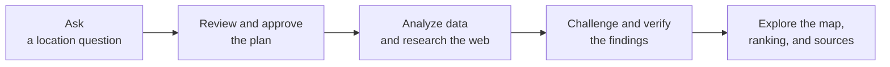
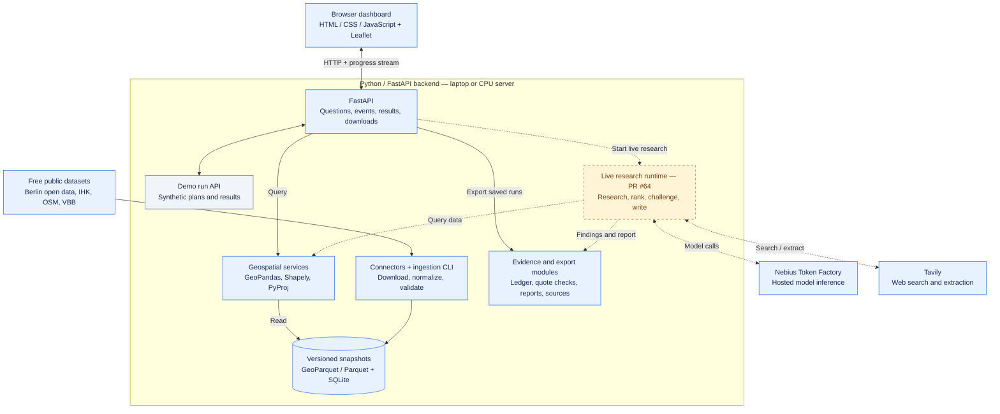
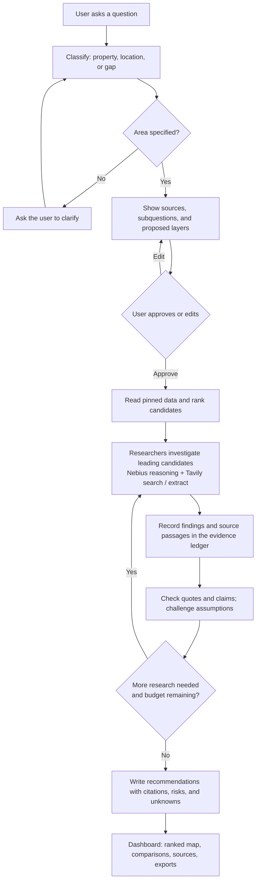

# Risalite — Agentic Deep Research for Berlin Locations

**Challenge:** Agentic Deep Research with Nebius Token Factory & Tavily

## TL;DR

**What it is:** Risalite is a web application for choosing locations for businesses and public services in Berlin. Ask “Where should I open a coffee shop in Kreuzberg?” The intended answer is a ranked shortlist, an interactive map, and a report with evidence, risks, and source links. SpotWise is the demo of that experience.

**Why it helps:** location decisions require piecing together population, competitors, transport, planning information, and local news. Risalite brings those sources into one investigation, makes tradeoffs visible, and explains what evidence could change the recommendation.

**How it works:** approve a research plan → analyze public data and rank locations → investigate candidates on the web → challenge and verify findings → explore the results. Calculations produce the numeric metrics and ranking; AI agents investigate, check evidence, and explain the answer.

**How it is built:** HTML/CSS/JavaScript and Leaflet in the browser; Python/FastAPI, GeoPandas, Shapely, and PyProj on the backend; GeoParquet/Parquet snapshots with a SQLite catalog for storage. DeepAgents research uses **Nebius Token Factory** for hosted models and **Tavily** for web search/extraction. The application runs on a laptop or CPU server.

**Where we are:** the data connectors, dashboard, evidence modules, and provider adapters are implemented. The dashboard currently uses demo fixtures; the complete live agent integration is in progress. **Coming next:** validated live research, a public HTTPS demo, and broader property-level and childcare workflows. See the [status and roadmap](#status-and-roadmap).

## Watch the demo

▶ **[Watch the SpotWise demo on YouTube](https://youtu.be/9fVmrUtZCX8)** · [Download the video — 1:57, with captions](docs/video/SpotWise_demo.mp4) · [Without captions](docs/video/SpotWise_demo_nocaptions.mp4) · [Video breakdown](docs/video/README.md)

The current video presents the intended experience using the dashboard mockup, synthetic fixtures, and research-flow slides. A recording of a complete live run is a release milestone.

### The experience at a glance



<details>
<summary>Editable Mermaid diagram</summary>



</details>

*The diagram shows the intended complete experience. The status and roadmap below separate available components from ongoing integration and future work.*

[Status and roadmap](#status-and-roadmap) · [Architecture](#architecture) · [Research flow](#research-flow) · [Data connectors](#data-connectors) · [Run locally](#run-it) · [Project documents](#key-documents)

## Architecture

The application has two complementary paths: public datasets are imported into reusable snapshots, while research agents investigate questions using those snapshots and live web sources. The diagram includes the target live integration.

**Blue:** available components. **Grey:** fixture-backed demo. **Amber:** integration in progress. **Dashed arrows:** connections being integrated.



[Open the architecture diagram at full size](docs/diagrams/architecture.svg)

<details>
<summary>Editable Mermaid diagram</summary>



</details>

Nebius runs the models remotely. The application can run locally or on a CPU server, with provider credentials supplied only to backend processes. The [connector blueprint](CONNECTOR_BLUEPRINT.md) covers typed records, caching, validation, snapshot compatibility, and provenance. The [standalone experiment](backend/experiments/README.md) is separate from the dashboard's live runtime.

## Status and roadmap

The project is being developed in parallel. This is a snapshot of published `main` and the open integration work, checked on **18 October 2026**. A connector being implemented does not mean its dataset is imported on every machine or integrated into every research workflow.

| Stage | What it includes | Status |
|---|---|---|
| Data foundation | 21 documented dataset connectors/configurations, typed contracts, ingestion CLI, validation, versioned snapshots, provenance, and read APIs | Available on `main`; coverage and access restrictions vary by dataset |
| Map and dashboard | Question entry, editable plan, progress trace, map, layer controls, sources, and report/source exports | Available on `main`; research runs currently use synthetic fixtures |
| Evidence foundation | Evidence ledger, quote matching, fact-check modules, and citation-checking CLI | Available on `main`; full live workflow integration is in progress |
| Hosted AI and web research | Nebius structured-inference adapter, Tavily search/extract adapter, and a separate DeepAgents experiment | Implemented; provider credentials and credits required |
| Live application runtime | Data analysis, deterministic ranking, researchers, skeptic, fact-check, writer, and live run endpoints | In progress in [PR #64](https://github.com/roger704/Risalite-hackathon/pull/64); not yet merged at this check |
| SpotWise reports | Recommendations, risks, and what could change the answer, using the live runtime | In progress in [PR #66](https://github.com/roger704/Risalite-hackathon/pull/66), stacked on #64 |
| Public release | One HTTPS link for the frontend and API, persistent runs, usage limits, and a live demo recording | Next release milestone; deployment remains to be validated |

### Next: a public coffee-location demo

1. Finish and review the live runtime integration and its dependent report changes.
2. Import and pin the datasets needed for the selected Berlin demo area.
3. Verify the browser flow with actual Nebius calls, Tavily research, and source-backed findings.
4. Persist completed runs and handle interrupted research, timeouts, and provider errors.
5. Add public-access controls for concurrency, per-visitor usage, and a global research budget; keep provider keys on the backend.
6. Deploy the frontend and API together behind HTTPS, verify the public URL, and record a complete live run.

### Then: broader location intelligence

| Direction | What we want to add | What still needs work |
|---|---|---|
| Property / storefront research | Top business hypotheses for a specific address and an operator profile | Complete and validate the point workflow; connect address, building, parcel, and catchment context |
| Childcare gaps | Compare child population with nearby Kita provision | Validate the gap model and coverage; permitted places must remain distinct from vacancies |
| Richer neighborhood context | Households, green spaces, retail centers, development plans, environmental indicators, and Wohnlagen | Connect existing snapshots to research tools, maps, and explanations; confirm reuse terms before enabling blocked sources |
| What-if exploration | Change priorities and compare how rankings move | Extend the existing layer controls with validated scenarios; label unsupported assumptions |
| Explainable comparisons | Compare finalists and inspect supporting and conflicting evidence | Build richer location comparisons and an evidence graph linked to the ledger |
| More places and services | Reuse the research approach for gyms, coworking, schools, and healthcare | Add use-case-specific metrics, source review, and validation before extending beyond Berlin |

## Research flow

This is the intended integrated workflow. The current dashboard demonstrates the interface with fixtures; live execution is being connected in #64. Classification and planning in that PR currently use rules; model-driven planning remains a future improvement.



<details>
<summary>Editable Mermaid diagram</summary>



</details>

Every reported fact should lead back to its dataset snapshot or original web source. Data analysis produces the numeric metrics and ranking; models investigate and explain them. Unsupported claims belong in explicit assumptions or unknowns. Quote matching establishes support in a passage; it does not guarantee that the source itself is correct.

## Key documents

| Document | Purpose |
|---|---|
| [Risalite spec](docs/01_Architecture/Risalite_Spec.md) | Product spec: input flow, templates, dashboard, `cells.json` data model, decisions log, open decisions, storyboard, risks |
| [Execution plan](docs/02_State/Execution_Plan.md) | Hour-by-hour plan for hackathon day with checkable items — this **is** the todo list |
| [Data sources research](DATA_SOURCES.md) | Free datasets, access methods, licensing, limitations, integration order |
| [Connector blueprint](CONNECTOR_BLUEPRINT.md) | Adapter designs, shared data contracts, caching, provenance |
| [Landing page](frontend/landing/README.md) | Animated, looping landing page: what Risalite is for, the workflow and the deliverables, in 10 seconds |
| [Backend setup guide](backend/README.md) | Per-connector import and query details, ingestion CLI, versioned snapshots, read API |
| [Demo script](docs/02_State/Demo_Script.md) | Rehearsal questions per template and the two-minute storyboard |
| [Deep research experiment](backend/experiments/README.md) | Isolated Python 3.12 DeepAgents + Nebius Token Factory + Tavily research loop; local, Docker, and CPU-only Nebius VM deployment |

## Data connectors

The backend imports each dataset into an immutable local snapshot with provenance (source URL, retrieval time, licence, attribution, quality report). Nothing is downloaded at query time. Configurations live in [`backend/config/datasets/`](backend/config/datasets/); design rules are in the [connector blueprint](CONNECTOR_BLUEPRINT.md).

### Quick start

```sh
cd backend
uv sync
uv run location-data datasets                    # list datasets and local snapshots
uv run location-data ingest berlin_lor           # boundaries first: most datasets join to them
uv run location-data ingest berlin_population    # then any dataset from the table below
uv run location-data records berlin_population --snapshot <snapshot_id> --area-code 01100101 --limit 10
uv run uvicorn app.api.main:app --reload         # read API, docs at http://127.0.0.1:8000/docs
```

- `ingest <dataset>` prints a manifest with its `snapshot_id`. Pin a boundary edition with `--lor-snapshot <id>`, or import a previously downloaded file with `--file <path>`. A failed import leaves the previous snapshot active.
- Every `records` and API query takes an explicit `snapshot_id`. Global options such as `--data-dir` go **before** the subcommand; `LOCATION_DATA_DIR` sets the store for CLI and API.
- No API keys are needed for these datasets. Live provider tests are opt-in: `RUN_LIVE_TESTS=1 uv run pytest -m live tests/live`.

### Datasets

| Dataset ID | What it contains | Import first | How to query | Details |
|---|---|---|---|---|
| `berlin_lor` | 542 LOR Planungsräume (boundaries, WGS84) | — | `records`; base for every area join | [docs](backend/README.md#import-the-official-data) |
| `berlin_lor_names` | Official names of Planungsraum, Bezirksregion, Prognoseraum, Bezirk | `berlin_lor` | `records --area-code` | [docs](backend/README.md#official-lor-names-berlin_lor_names-berlin_wfs) |
| `berlin_population` | Registered residents per Planungsraum (age bands) | `berlin_lor` | `records --metric-code population_total` | [docs](backend/README.md#inspect-snapshots) |
| `berlin_population_density_blocks` | Residents per block (Umweltatlas 2023); 0–2 residents suppressed, not 0 | `berlin_lor` | `records` | [docs](backend/README.md#population-density-blocks-berlin_population_density_blocks) |
| `berlin_households` | 27 household-structure metrics per Planungsraum (2025-12-31) | `berlin_lor` | `records --metric-code` | [docs](backend/README.md#berlin-household-profiles-berlin_households) |
| `berlin_population_forecast` | Population forecast 2024–2040 per Prognoseraum. **Import blocked** until reuse terms are confirmed | `berlin_lor` | `GET /api/v1/population-forecast/expected-change` | [docs](backend/README.md#berlin-population-forecast-berlin_population_forecast) |
| `zensus_grid` | Census 2022 100 m population grid (not register population) | `berlin_lor` | `catchment zensus_grid --lon --lat --radius-m` | [docs](backend/README.md#zensus-2022-population-grid) |
| `ihk_businesses` | IHK Berlin registered businesses (NACE) | `berlin_lor` | `records`; counted separately from OSM | [docs](backend/README.md#ihk-businesses-ihk_businesses) |
| `osm_pois` | OSM points of interest from the pinned Geofabrik extract (`osm_pois_overpass`: optional small bbox) | — | `records` | [docs](backend/README.md#openstreetmap-points-of-interest) |
| `vbb_gtfs` | VBB stops/stations and scheduled departures per time window (supply, not footfall) | — | `records` | [docs](backend/README.md#vbb-gtfs-scheduled-service-summaries) |
| `berlin_traffic_volumes_2019` | Motor vehicles per day per road segment, 2019 (not pedestrians) | — | `records` | [docs](backend/README.md#road-traffic-volumes-2019-berlin_traffic_volumes_2019-berlin_wfs) |
| `berlin_bicycle_counts` | Official bike counters, daily and window totals 2012–2025 (cyclists only) | — | `GET /api/v1/datasets/berlin_bicycle_counts/layers/counters` | [docs](backend/README.md#berlin-bicycle-counters-berlin_bicycle_counts) |
| `berlin_kitas` | Kitas with permitted places (not vacancies) | `berlin_lor` | `GET /api/v1/childcare/facilities`, `/api/v1/childcare/areas` | [docs](backend/README.md#official-kita-registry-berlin_kitas-berlin_wfs) |
| `berlin_parks` | Official green spaces and playgrounds | `berlin_lor` | `GET /api/v1/datasets/berlin_parks/green-spaces/nearby` | [docs](backend/README.md#official-green-spaces-and-playgrounds-berlin_parks-berlin_green_spaces) |
| `berlin_centers` | StEP Zentren 2040 shopping centres and retail-park sites | `berlin_lor` | `GET /api/v1/datasets/berlin_centers/nearby` | [docs](backend/README.md#berlin-retail-centers-berlin_centers) |
| `berlin_planning` | Development plans (Bebauungspläne) with procedure status | `berlin_lor` | `GET /api/v1/planning/plans/near`, `/in-area`, `/{plan_id}` | [docs](backend/README.md#berlin-development-plans-berlin_planning) |
| `berlin_environment` | 9 Umweltgerechtigkeit indicator classes per Planungsraum (categories, no score) | `berlin_lor` | `records`; `GET /api/v1/datasets/berlin_environment/legend` | [docs](backend/README.md#berlin-environmental-indicators-berlin_environment) |
| `berlin_addresses` | 402,756 official address points with Planungsraum | `berlin_lor` | `GET /api/v1/datasets/berlin_addresses/address-search` | [docs](backend/README.md#berlin-address-points) |
| `berlin_mietspiegel_wohnlagen` | Mietspiegel 2026 Wohnlage (einfach/mittel/gut) per address; not income or rent | `berlin_lor`, `berlin_addresses` | `GET /api/v1/datasets/berlin_mietspiegel_wohnlagen/wohnlage` | [docs](backend/README.md#berlin-mietspiegel-2026-address-level-wohnlagen) |
| `berlin_alkis_buildings` | ALKIS building footprints, function, storeys (bounded test area around Kottbusser Tor) | — | `GET /api/v1/datasets/berlin_alkis_buildings/at`, `/by-address`, `/buildings/{id}` | [docs](backend/README.md#alkis-building-footprints-berlin_alkis_buildings) |
| `berlin_alkis_parcels` | ALKIS parcels with official area (bounded 5×5 km central area) | `berlin_lor` | `GET /api/v1/parcels/at`, `/in-bbox`, `/{parcel_id}`, `/{parcel_id}/relations` | [docs](backend/README.md#alkis-parcels-berlin_alkis_parcels) |

All `records` commands also exist as `GET /api/v1/datasets/{dataset_id}/records?snapshot_id=...`.

### Cross-dataset endpoints and services

| Feature | How to use | Details |
|---|---|---|
| Area summary | `GET /api/v1/areas/{area_code}/summary`: population, OSM and IHK competitor counts (kept separate), nearest stations, each value with status, unit, source snapshot and date | [docs](backend/README.md#area-summary) |
| Walking routes and reachable areas | Self-hosted Valhalla: `backend/routing/build_valhalla_graph.sh`, then `run_valhalla_service.sh`; `GET /api/v1/routing/walking/route`, `/reachable-area`, `/status` or `uv run location-routing ...` | [docs](backend/README.md#walking-routes-and-reachable-areas-valhalla) |
| Research clients | Tavily search/extract and Nebius Token Factory; need `TAVILY_API_KEY`, `NEBIUS_API_KEY`, `NEBIUS_MODEL` | [docs](backend/README.md#research-adapters-tavily-nebius) |

### Reading the data correctly

- Missing or suppressed values are reported as such, never as 0.
- OSM and IHK business counts are separate inventories; don't add them up.
- Transit departures, road traffic and bike counts are not pedestrian footfall.
- Straight-line distances are never walking times.
- Development plans, addresses, buildings and parcels say nothing about vacancy, tenants, permitted use or rentable area. Wohnlage is not income or rent.
- Census grid (`zensus_grid`) and register population (`berlin_population`) must not be mixed.

## Run it

These commands start the dashboard and API from published `main`. Research runs use synthetic fixtures until the live runtime is integrated. No provider keys are needed to preview that interface.

```bash
git clone https://github.com/roger704/Risalite-hackathon.git && cd Risalite-hackathon
cp .env.example .env            # fill locally when testing provider clients
cd backend
uv sync
uv run uvicorn app.api.main:app --reload   # dashboard + API on http://127.0.0.1:8000/
```

Open the dashboard at [http://127.0.0.1:8000/](http://127.0.0.1:8000/) and the API docs at [http://127.0.0.1:8000/docs](http://127.0.0.1:8000/docs). A `.env` file is not loaded automatically by these commands; export its variables in the backend process environment when making provider calls.

From `backend/`, check the citations of a saved run (report marker → ledger entry → URL resolves → quote re-matches). Set `RUN_ID` to an actual persisted run ID:

```bash
RUN_ID=replace-with-a-persisted-run-id
uv run python ../scripts/verify_citations.py "../runs/$RUN_ID" --threshold 0.9
uv run python ../scripts/verify_citations.py ../frontend/fixtures --offline
```

`--offline` checks citation mapping and stored passages only. Online, quotes are re-fetched with Tavily `extract` when `TAVILY_API_KEY` is set, else a direct HTTP GET.

### Evidence and fact-check (`backend/app/evidence/`)

| Module | Role |
|---|---|
| `ledger.py` | Append-only `runs/<id>/evidence.jsonl`: Tavily `WebEvidence` (`ev_…`) and snapshot values (`ds_…`, value hash); status changes are new revisions |
| `matching.py` | Shared quote matcher: verified ≥ 0.85, partial ≥ 0.60 |
| `factcheck.py` | Re-fetch per source (Tavily extract / HTTP with per-hop SSRF checks / allow-listed WFS + Overpass re-query / snapshot re-read); writes `factcheck.json`, `findings.jsonl` verification, `fact_check` trace events, strips uncited markers from `report.md` and appends "Could not verify" |
| `judge.py` | Score used by `scripts/verify_citations.py` |

## Input flow details

1. **Free question** in a text box (+ optional role).
2. **Classify** — the planner decides the question shape and logs why: `point` (one property/storefront), `location` (where to put something), or `gap` (where something is missing).
3. **Clarify** if the area is unspecified — one question back to the user. Never guess an area.
4. **Derive the area** — `point` → parcel + ~100 m neighbourhood; `location`/`gap` → named Bezirk/Ortsteil resolved to PLR cells.
5. **Present the plan** — sub-questions, source class per sub-question, exact layers/domains, and optional paid sources shown as "key not provided — skipped". The user **approves** (or edits) before research starts.
6. **Research → evidence ledger → fact-check → write.**
7. **Dashboard** rendered from `report.md`, `evidence.jsonl`, `trace.jsonl`, and `cells.json` / `candidates.json`.

## Use cases and intended outputs

| | T1 Property / point (LocalLens) | T2 Business location | T3 Kita gap |
|---|---|---|---|
| Shape | `point` | `location` | `gap` |
| Example | "This storefront at Xstraße 12 just became available — what is the best use?" | "Where is it smart to open a coffee place in Kreuzberg?" | "Where are Kitas missing in Neukölln?" |
| Area | parcel + 100 m | district → PLR cells | district → PLR cells |
| Output | top-3 business hypotheses with for / against / unknowns, scored on six dimensions | **top-3 ranked cells** + score **heatmap** + layer panel | same as T2 with a gap score |

Release priority: **T2 coffee (area) end-to-end with clickable citations** comes first. T1 property research and T3 childcare gaps expand the product as their workflows are validated. The table describes intended outputs, not a guarantee that all templates are ready.

## Dashboard (one shared skeleton)

1. Question, role, and approved plan (collapsed)
2. Summary of findings with inline `[n]` citations (T2/T3 labelled "written for the default layer mix")
3. Findings — ranked top-3 (area) or top-3 hypotheses (point), plus a Location/Hypothesis Battle
4. Map — PLR heatmap with hover values and citation links; point mode shows the space, its cell, and competitors
5. Layer panel — checkboxes with default weights and a **Present / Present + future** toggle; recomputes score, heatmap, and top-3 client-side
6. Sources — generated from the ledger only: URL, verbatim quote, method, confidence badge, and a "could not verify" appendix
7. Trace — plan, every tool call with *why*, skipped paid sources, fact-checker rejections, model per role, tokens, seconds

## Technology

- **Nebius Token Factory** — hosted model inference for researchers, skeptic, and writer; model-driven classification and planning are a future improvement.
- **Tavily** — `search` (domain-restricted first) and `extract` for verbatim quotes.
- **Berlin open geodata** — `lor_2021` (PLR geometries), `ua_einwohnerdichte_2025`, `mss_2025`, `gewerbedaten` (NACE 56), `oepnv_ungestoert`, `schulen`, `brw2026`, `wohnlagenadr2026`, `kita`, `step_wo_2040`, `adressen_berlin`; plus OpenStreetMap via Overpass.
- **Optional paid slots** (skipped unless a key is given) — hystreet.com footfall, Google Places competitor ratings.
- **Application** — Python + FastAPI backend; HTML/CSS/JavaScript dashboard, Leaflet map, and client-side layer controls, served by FastAPI.

## Work streams

- **S1 — Agent & orchestration (area):** classify → plan → approve → researchers → skeptic → fact-checker → writer; research events; HTTP API.
- **S1b — Point path (LocalLens):** hypotheses → per-hypothesis FOR/AGAINST researchers → operator-fit scoring → `candidates.json`.
- **S2 — Data & scoring:** PLR cells, WFS/Overpass layers, normalization, scoring, `cells.json`; `locate(address)` for the point path.
- **S3 — Frontend:** dashboard, map, layer mixer, live investigation view, sources; both result shapes.
- **S4 — Evidence & delivery:** ledger, fact-checker, `verify_citations.py`, README, repo, rehearsal, video.

Frozen contracts (see the spec): HTTP API (`POST /research`, `POST /runs/{id}/approve`, `GET /runs/{id}/events` SSE, `GET /runs/{id}/result`), research event, ledger entry, `cells.json`, `candidates.json`.

## Hackathon schedule — Sunday 18 Oct 2026

| Time | Phase |
|---|---|
| 14:50–15:10 | Phase 0 — freeze contracts, demo district, demo storefront + operator profile |
| 15:10–16:30 | Phase 1 — build in parallel |
| 16:30–17:00 | Phase 2 — integrate; **17:00 feature freeze** |
| 17:00–17:45 | Phase 3 — harden and rehearse |
| 17:45–18:30 | Phase 4 — record and **submit video by 18:30** |
| 18:30–20:00 | Phase 5 — grand-final prep (final at 20:00) |

## Target two-minute demo storyboard

0:00 type "Where is it smart to open a coffee place in Kreuzberg?" → 0:10 planner classifies `location`, shows the plan with layers, web sources, and skipped hystreet/Google Places slots → 0:25 click *Approve* → 0:30 trace streams WFS calls and Tavily searches with *why* → 1:00 fact-checker rejects one web claim, planner re-plans → 1:15 dashboard: summary, top-3, heatmap → 1:30 toggle *Present + future*, untick *competition*, ranking changes → 1:45 click three citations (WFS URL, IHK/berlin.de page, news page) → 2:00 self-grade. Closing switch: point path or Kita.

## Out of scope

- Precise commercial revenue predictions.
- Comprehensive rental property availability.
- Automatically verified premises or permits.
- Model-estimated magnitudes — numbers appear only when a source states them.

## Success criteria

These are acceptance criteria for the complete live release.

A judge can:

1. Type a real location question and approve the plan.
2. Watch the agent make autonomous research decisions with visible *why*.
3. See real public data influence the ranking.
4. Click and verify randomly selected citations (`verify_citations.py` passes 100 % on demo runs).
5. Understand why the recommendation was made — and what evidence could change it.
