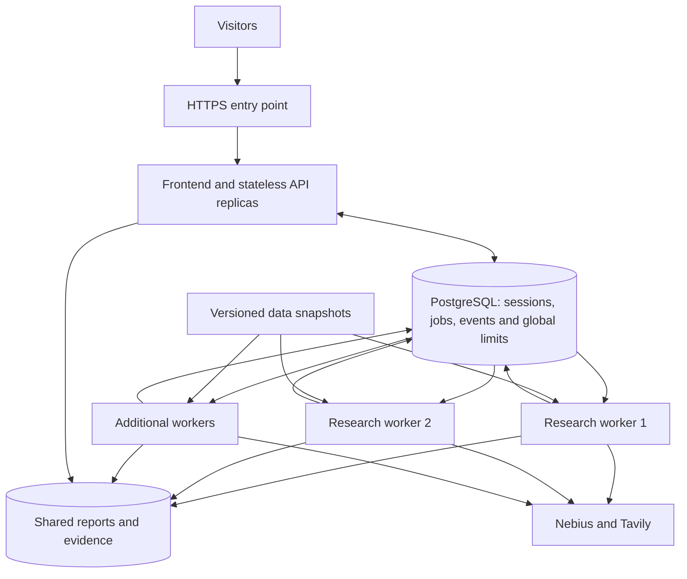

# Scaling SpotWise across machines

**Status: planned, not implemented.** Saved on 18 October 2026. The public review deployment still uses one API process, one active investigation and a persistent cap of 20 admitted investigations. This document does not provision infrastructure or raise those limits.

## Goal

Allow multiple visitors to research concurrently, queue excess work, and keep plans, progress and completed results available when an API process restarts or a request reaches another machine.

Worker slots are independent of machine count. Start with two slots, load-test them, and then place workers on additional CPU machines as resource measurements and provider quotas allow. Models continue to run through Nebius Token Factory; application workers do not need local GPUs.

## What prevents horizontal scaling today

- `backend/app/application/runs/service.py` holds runs and asyncio tasks in process memory. Approval starts the pipeline inside the API process. Ordinary session lookup does not reload persisted runs.
- `backend/app/application/runs/events.py` keeps the event list in process memory and appends local JSONL files. Another machine cannot serve that live stream.
- `backend/app/api/runs_live.py` creates a process-local service. Increasing Uvicorn workers would create separate run stores and concurrency counters.
- `backend/app/application/runs/budget.py` stores admissions in local SQLite. Separate copies would each admit their own budget.
- Reports, evidence and snapshot/catalog files live on one machine's disk.

Keep the existing pipeline and browser contracts where possible. Extract persistence and execution behind small interfaces rather than rewriting research or scoring.

## Proposed components

| Component | Responsibility |
|---|---|
| Web/API | Serve pages; create and edit plans; authenticate run tokens; enqueue approvals; stream persisted events; return results and exports |
| Run repository | Persist question, token hash, plan, approval, status, timestamps, snapshot versions, result manifest and errors |
| Job queue | Persist approved work; atomically claim jobs; maintain leases, attempt IDs, heartbeats and cancellation state |
| Event store | Append ordered events per run and support replay after `Last-Event-ID` from any API replica |
| Artifact store | Store evidence ledgers, reports, CSVs and result documents in private shared object storage |
| Snapshot provider | Give workers identical, immutable dataset versions and compatible local read-only catalogs/caches |
| Admission policy | Enforce one shared total-run budget, active-run capacity, bounded queue length and provider request limits |

Use **PostgreSQL for the first queue and shared metadata store** to keep the initial deployment small. A job table with short `FOR UPDATE SKIP LOCKED` claim transactions supports multiple consumers. Do not hold database locks while research executes. A separate Redis/Celery deployment can be evaluated later if scheduling requirements justify another service.

## Job lifecycle and correctness

1. Create a plan and persist its hashed bearer token. Planning does not consume an admitted-run slot.
2. On approval, validate the plan and atomically reserve the existing total-run budget and insert one job. Use a unique run ID to make repeated approval idempotent. Queue-full or invalid requests must not consume the budget.
3. Return a queued status and queue-position/progress information to the browser. Queuing is distinct from actively spending provider credits.
4. A worker claims an available job and an active slot in a short transaction. It records a lease owner, attempt ID and expiry, then periodically renews the lease.
5. Execute the current pipeline in an attempt-specific working directory. Append events to the shared store and upload artifacts under an attempt-specific prefix.
6. Publish completion only if the worker still owns the current lease/attempt. Atomically select the completed artifact manifest and release capacity. A stale worker must not overwrite the current result.
7. On worker loss, expire the lease and expose an interrupted state. Initially require an explicit retry for investigations that may already have spent provider credits; add automatic stage retries only after defining safe checkpoints and cost accounting.

Delivery is not an exactly-once guarantee for external model/search requests. Leases and idempotency prevent duplicate admission and stale publication, but a process can fail after a provider charged a request. Bound retry attempts and account for that spend.

## Progress, storage and security

- Persist monotonic event sequence IDs and page event reads. SSE reconnects replay stored events; notifications may wake readers but are not the source of truth. Avoid the current per-client 100 ms polling loop against the database.
- Keep run-token authorization on plans, events, results and exports regardless of which API replica receives the request. Store only token hashes; keep provider credentials server-side.
- Keep database, worker endpoints and artifact buckets private. Use private networking and scoped credentials. Browser downloads go through the authorized API or short-lived authorized download URLs.
- Pin each investigation's dataset snapshot IDs. Fetch immutable snapshots to worker-local caches; do not share a writable SQLite catalog over a network filesystem or let workers ingest independently during a run.
- Bound queue size, global active jobs, provider requests in flight, timeouts, search/extract counts and retries. Add per-visitor admission controls before opening larger capacity publicly.

## Migration and rollout

1. **Persistence first:** introduce repository/event/artifact interfaces with local adapters so the existing single-process mode stays usable. Add restart recovery for completed runs and plans.
2. **Database and worker mode:** add PostgreSQL migrations and adapters, queued approval, a separate worker entry point, shared progress and results, and a local multi-process development setup.
3. **Import existing state:** drain active research; back up the run directory and SQLite budget; migrate run IDs, token hashes, events, terminal results and every historical admission, including failures. Preserve the maximum of 20 admitted runs across the entire deployment. Mark interrupted work explicitly; do not silently replay it.
4. **Validate two workers:** exercise concurrent visitors, reconnects, job duplication, crashes and budget races with fake providers. Measure RAM and CPU with real snapshots. Use separately budgeted live checks only after offline validation.
5. **Deploy gradually:** retain the current server as the initial HTTPS/API entry point, add private worker capacity, then add API replicas/load balancing if needed. Review estimated infrastructure costs against the approved US$5/day budget before provisioning. Increasing the 20-run cap requires a separate decision.
6. **Rollback:** stop admissions and drain workers before reverting. Preserve migrated admissions and completed results; never reset the budget or replay jobs during rollback.

## Acceptance checks

- Create on API A, approve on API B, reconnect events on A, and download the completed result through B using the same run token.
- Two workers claim different jobs and execute concurrently; extra work waits in a bounded queue.
- Simultaneous approvals cannot exceed the global admission cap or create duplicate jobs.
- Killing a worker releases capacity after lease expiry; stale attempts cannot publish results or append current-attempt events.
- Restarting the API preserves plans, event replay, results and authorization. Invalid tokens still receive 404.
- Disabled/changed layers and weights produce the same deterministic ranking as the existing scoring parity tests.
- No regression to the landing page, research app, citations, exports, Nemotron configuration or seven imported café datasets.

## References

- [PostgreSQL SELECT locking and SKIP LOCKED](https://www.postgresql.org/docs/current/sql-select.html)
- [Celery task queues and distributed workers](https://docs.celeryq.dev/en/stable/getting-started/introduction.html), an alternative to evaluate later
- [Current Nebius deployment and operating limits](deploy/nebius/README.md)
- [Connector blueprint and snapshot contracts](CONNECTOR_BLUEPRINT.md)
