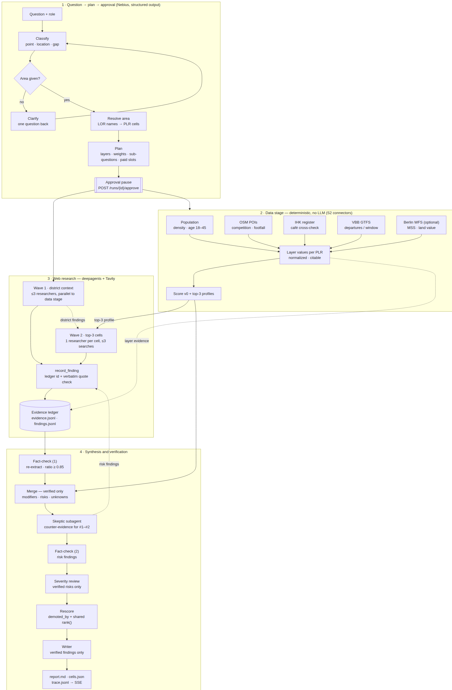
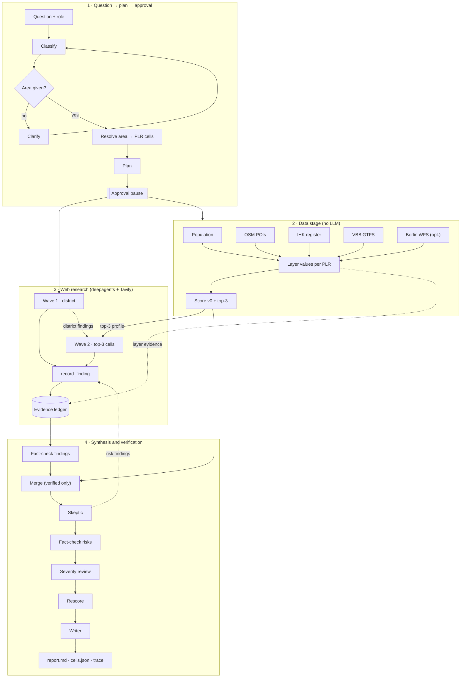

# Risalite — Deep Research Flow Spec (S1)

> **Status: draft for review, no implementation yet.** Owner: S1 (deep research team). Reviewer: please comment inline on the PR.
> Scope: everything between "user typed a question" and "result files are written". Data connectors and scoring (S2) and the frontend (S3) are owned by other people; this spec defines the contracts we need from and give to them.
> Builds on: `Risalite_Spec.md` (product, `cells.json`), `Execution_Plan.md` (streams, timeline), PR #6 (Tavily client, Nebius gateway, research budgets), the Nebius cookbook *deep-research-agent-tavily* (deepagents + `ChatNebius` + Tavily).

## 1. Summary

**Data first, web explains.** The Berlin connectors compute the numbers per PLR (Planungsraum) without any LLM. Deepagents researchers then search the web in two waves: wave 1 covers the whole district, wave 2 digs into the top-3 cells the data produced. Every claim becomes a *finding* with a verbatim quote and an evidence id in the ledger. A skeptic actively looks for counter-evidence, a deterministic fact-checker re-verifies everything, and the writer may only use verified findings.

Hard rules:

1. No LLM computes numbers. Scores are computed deterministically from layer values (scoring v2, §5.8).
2. No sentence in the report without a ledger id. Citations that are not in the ledger are stripped.
3. OSM and IHK café counts are never added up; IHK is a cross-check for OSM.
4. A future development counts only if the source dates it after today. A magnitude is attached only if the source states a number.
5. Research never starts before the user approved the plan.

## 2. Decisions

| # | Topic | Decision | Status |
|---|---|---|---|
| E1 | Framework | `deepagents` (`create_deep_agent`, researcher subagents) inside a deterministic Risalite-owned run shell | confirmed |
| E2 | Researcher granularity | **Two waves**: wave 1 = up to 3 district sub-questions, started right after approval in parallel with the data stage; wave 2 = one researcher per top-3 cell, driven by the cell's data profile; wave 2 behind a flag | confirmed (C) |
| E3 | Approval | **HTTP pause before the agent** (`awaiting_approval` → `POST /runs/{id}/approve`); not deepagents `interrupt_on`. Mid-run `interrupt_on` for budget extension is a stretch | confirmed (A) |
| E4 | Skeptic | **Skeptic subagent collects counter-evidence, a structured review call judges severity** on verified risks only; fallback flag = review call only | confirmed (C), 2026-10-18 |
| E5 | Fallback | Same tools and ledger in a fixed staged pipeline (u14app-style: queries → search → extract → record → fact-check → write), switchable via `RESEARCH_MODE=agent|staged` | confirmed |
| E6 | Ownership | S1 owns the complete research flow incl. ledger, fact-checker, writer, events, HTTP API. S1 also owns the scoring engine logic (S11, §5.8); S2 owns connectors and raw layer values (via #36), S3 owns the frontend | confirmed |
| E7 | Contracts | Event, ledger, finding, plan, data port as in §9 plus M1–M6, D9 event types and the §5.8.7 score fields; frozen after one joint S1/S3 review | confirmed |
| E8 | Models | Configurable per role; no Kimi; bake-off candidates Nemotron (Nebius), DeepSeek-V4.1-Flash, optionally MiniMax-M3 (§10) | confirmed |
| D1 | Contracts | S3 contracts (`backend/app/contracts`, PR #19) are the source of truth; this spec's additions (§9.6, M1–M6) are added there | confirmed (C), 2026-10-18 |
| D2 | Data input | Data stage reads the area-summary API (PR #36) plus ports for Kitas (#38), centres (#41), B-Pläne (#43), forecast (#48) | confirmed (C) |
| D3 | T2 layers | Cleaned `coffee_v1`: IHK only as cross-check, transit fix, plus block density (#37) and centre proximity (#41); mockup adopts real layer names; superseded in detail by `coffee_v2` (§5.8.2) | confirmed (B) |
| S1–S11 | Scoring engine | `scoring v2` (§5.8): new engine re-using the structure of PR #14; values via #36 (S2); saturation + agglomeration instead of café counts; IHK cross-check only; percentile normalization; area **and** Berlin reference; signed graded future modifiers; rule-based confidence; tiers, stability, `rank()`; one rule for S2/S3 with golden vectors; engine logic owned by S1 | confirmed, 2026-10-18 |
| D4 | Future modifiers | Structured first (B-Pläne, forecast), web supplements | confirmed (B) |
| D5 | T3 | Second template `kita_gap_v1` if #38 exposes approved places, otherwise mockup preview only | confirmed (B, conditional) |
| D6 | T1 | LocalLens (Execution Plan S1b, `candidates.json`); no §34 story stack (no ALKIS data); hypotheses only from `t1_catalog_v1` (§6); owner pending: S1 or demo preview only (Eraldo = runtime/hosting) | confirmed (B) |
| D7 | T1 dimension scores | Data-backed dimensions deterministic; operator/space fit by LLM with mandatory evidence ids; weak-tier-only dimensions capped | confirmed (B) |
| D8 | Score rule | One rule in Python (S2) and JS (S3), guarded by shared golden test vectors | confirmed (C) |
| D9 | Events | `events.ResearchEvent` (PR #19) + `replan`, `skip`, `rescore`, `role` | confirmed (C) |
| D10 | Models | Configurable; second bake-off on the real runtime before fixing defaults (candidates in §10) | confirmed |
| F1 | Data deliverables (S2) | Via #36/ports: block density (#37), complementary OSM POIs per PLR, transit for 07–10 and 16–19 with correct projection, distance to nearest centre (#41), Kita capacities (#38); handed over as a fixed list, S2 acknowledges `AreaDataPort` | confirmed, 2026-10-18 |
| F2 | Wave-2 trigger / display | Wave 2 runs on the top-3 by `score_present`; the UI defaults to `score_present`, "with future" is a toggle | confirmed |
| F3 | Engine defaults | §5.8 values (weights, residents ≥ 2,000, tie 0.02, Berlin bands 0.40/0.70, bonus classes) are v2 defaults; sanity check on Kreuzberg once the runtime exists; Kita coverage target stays a parameter until sourced (Berlin Bedarfsquote) | confirmed |
| F4 | T1 catchment | 500 m by default; walking isochrone (#45) only if Valhalla runs in the demo environment | confirmed |
| F5 | Demo scope | T2 café Kreuzberg end-to-end; T1 if capacity allows; T3 limited (not all Kitas report capacity) | confirmed |

## 3. Flow



Source (editable): [`assets/deep_research_flow.mmd`](assets/deep_research_flow.mmd)

<details><summary>Mermaid (renders on GitHub)</summary>


</details>

### 3.1 What is processed when, and who uses it next

| Step | Input | Processing | Output → used by | LLM |
|---|---|---|---|---|
| 1 Classify | free text, role | type (`point`/`location`/`gap`) + area name + why | area resolution, template | yes, structured |
| 1b Clarify | missing area | one question back, never guess | user answer → classify | no |
| 2 Resolve area | area name | `berlin_lor_names` → Bezirk/Ortsteil → PLR ids + geometry | all layers, wave 1 localization, map | no |
| 3 Plan | type, area, available snapshots | layers (only those with a snapshot), default weights + why, wave-1 sub-questions, paid slots "key not provided — skipped" | approval → data stage, wave 1 | yes, structured |
| 4 Approve | plan + user edits | validate edits against plan schema | starts 5 and 6a in parallel | no |
| 5 Data stage | S2 snapshots | layer values per PLR, normalization, score v0, OSM↔IHK cross-check | top-3 profiles → wave 2; layers → ledger; `cells.json` | no |
| 6a Wave 1 | sub-questions + PLR list | search → extract → `record_finding` | future / risk / fact findings → merge, wave 2 | yes, agent |
| 6b Wave 2 | top-3 profile + wave-1 findings | targeted neighbourhood research | confirms / contradicts data → merge | yes, agent |
| 7 Fact-check (1) | wave-1/2 findings + dataset entries | re-extract, quote ratio ≥ 0.85; recompute layers from snapshot | only `verified` → merge | no |
| 8 Merge | **verified** findings + cell values | modifiers, risks, unknowns (rules §5.4); `build_cells` | `cells.json` v1, skeptic target | no |
| 9 Skeptic | #1–#2 of v1 with evidence | counter-evidence search | risk findings → fact-check (2) | yes, agent |
| 10 Fact-check (2) | skeptic risk findings | same as (1) | verified risks → review | no |
| 11 Severity review | verified risks | severity high/medium/low with ledger ids | rescore | yes, structured |
| 12 Rescore | severities | `demoted_by` on the cell, deterministic rank rule (§5.5) | `cells.json` final, `rescore` event | no |
| 13 Writer | verified findings + final cells | summary + per-cell reasons | `report.md`, dashboard | yes, structured |

## 4. Run lifecycle and HTTP API

```text
created → classifying → (needs_clarification ↺) → planning → awaiting_approval
        → approved → researching{data, wave1, wave2} → reviewing{factcheck, merge, skeptic, factcheck_risks, review, rescore}
        → writing → done
any state → failed (error event with reason) | cancelled
```

| Endpoint | Request | Response |
|---|---|---|
| `POST /research` | `{question, role?, template_hint?}` | `{run_id, run_token, status}`; status is `needs_clarification` (with `clarify_question`) or `awaiting_approval` (with `plan`) |
| `POST /runs/{id}/clarify` | `{answer}` | same as above (re-classify with the answer) |
| `POST /runs/{id}/approve` | `{area_id?, subquestions?, layers?: [{id, enabled, weight}], wave2?: bool}` | `{status: "approved"}`; `area_id` may be any Berlin unit id (from `plan.area_candidates` or from `GET /runs/{id}/areas`); if it differs from `plan.area.area_id`: load that area, regenerate the plan and return `{status: "awaiting_approval", plan}` (a second approve is needed); 409 if not `awaiting_approval`; 422 on schema violation (unknown layer id, weight outside 0–1, > 3 sub-questions, unknown `area_id`) |
| `GET /runs/{id}/areas?q=` | — | `[{area_id, level, name, bezirk}]` from `AreaDataPort.search_areas`; lets the user pick a different place than the one classification extracted (e.g. Mitte instead of Wedding) |
| `GET /runs/{id}/events` | — | SSE stream of events (§9.1); replays from `trace.jsonl`, supports `Last-Event-ID` = `seq` |
| `GET /runs/{id}/result` | — | `{status, report_md, cells, evidence, findings, metrics}` once `done`; 202 before |

**Access:** `run_id` is a random UUID4 and is not a credential. `POST /research` also returns a random `run_token`; every `/runs/{id}/…` endpoint requires it as `Authorization: Bearer <run_token>` (also for SSE: the frontend consumes the stream with `fetch` + `ReadableStream` (or `@microsoft/fetch-event-source`) instead of `EventSource`, so the token never appears in a URL; query-string tokens are not accepted) and answers 404 on a missing or wrong token, so run ids neither grant access nor reveal that a run exists. The token is stored hashed in the run directory. There are no user accounts in the hackathon scope; the token binds a run to the client that created it.

`/clarify` is new compared to `Execution_Plan.md` (the clarify step needs a way back in). Runs are stored in `runs/<run_id>/`; a run is restartable from any completed stage because every stage writes its artifact before the next one starts.

## 5. Stages in detail

### 5.1 Classify, clarify, resolve area, plan

- One `NebiusGateway.plan` call each for classify and plan, with Pydantic output models (`research_outputs.py`). Each output carries a `why` that is emitted as an event.
- Area resolution is deterministic against `berlin_lor_names` (S2). Ambiguous names (e.g. "Kreuzberg" = Ortsteil vs. "Friedrichshain-Kreuzberg" = Bezirk) resolve to the smallest matching unit; the plan carries `area: {area_id, level, name, plr_count}` and `area_candidates: [{area_id, level, name}]` with **all** matching units (e.g. Bezirk Neukölln and Ortsteil Neukölln as separate entries). The user corrects the area by sending another `area_id` with `approve`: a sibling candidate for a same-name ambiguity, or any unit found via `GET /runs/{id}/areas?q=` if classification extracted the wrong place. The id is loaded with `AreaDataPort.load_area(area_id)`, never re-resolved by name; identities are compared by `area_id` (e.g. `bezirk:08`, `ortsteil:0801`), never by name, and a changed id regenerates the plan before research starts.
- The plan only proposes layers for which `DataPort.available_layers` returns a snapshot. Template layer catalog for T2 coffee:

| Layer id | Source (S2) | Computation per PLR | Direction | Default weight |
|---|---|---|---|---|
| `demand_density` | population + LOR area | residents / km² | + | 0.30 |
| `demand_age` | population age bands | share 18–45 | + | 0.10 |
| `competition` | OSM `coffee_shop` (primary) | cafés per 1,000 residents | − | 0.25 |
| `footfall_poi` | OSM bakery, restaurant, fast_food, coworking | POIs / km² | + | 0.15 |
| `transit` | VBB GTFS | departures 07–10 h at stops in the cell | + | 0.20 |
| `cost` (optional) | Berlin WFS (land value / MSS) | value per cell | − | 0.00 (off by default) |

IHK (`56114`, `561141`) is not a scored layer; it feeds the cross-check in 5.2. `coffee_retail` is not counted as competition.

### 5.2 Data stage (no LLM)

- Runs immediately after approval, in parallel with wave 1.
- For each approved layer: `DataPort.layer_values(area, layer_id)` → raw value per PLR + `dataset_id`, `snapshot_id`, `source_url`. Each layer becomes one ledger entry (`method: "dataset"`), so numbers are cited exactly like web pages.
- **Source (D2):** values come from the area-summary API (PR #36), which returns per value `status`, `unit`, `sources`, `reference_period` and `calculation{id, version, method}` from pinned snapshots; these fields are copied into the dataset ledger entry. Template-specific ports add Kitas (#38), centres (#41), B-Pläne (#43) and the population forecast (#48).
- **T2 layers (D3):** density (block-based, #37, aggregated to PLR), share 18–45, competition = OSM cafés (IHK only for the cross-check below), transit departures (all-zero fixture must be fixed before use), centre proximity (#41). Weights are set in the template; there is no cost layer (no land-value connector), so cost stays a web topic.
- **Structured future modifiers (D4):** B-Pläne and forecast growth localized to a PLR become `future` modifiers before any web research, with the dataset entry as evidence (no web fact-check needed).
- **Dependency status (2026-10-18):** the S2 scoring engine (`backend/app/scoring/{scoring,build,layers,locate}.py`, `coffee_v1`) exists only on `devin/1792330050-s2-scoring`; PR #14 was closed unmerged with 6 open review findings, and `main` has only `backend/app/scoring/__init__.py`. PR #14 is **not** landed; S1 builds scoring v2 (§5.8) instead and re-uses its structure (S1, S11).
- Normalization and score v0 are computed by scoring v2 (§5.8). The layer table above is the earlier proposal; the adopted T2 layer set is `coffee_v2` (§5.8.2).
- **OSM ↔ IHK cross-check** per cell: if both counts ≥ 3 and `max/min > 2`, add an unknown `"café coverage: OSM {n} vs IHK {m}"` to the cell. Threshold is a proposal for review.
- Output: `cells.json` (v0) and the **top-3 profiles**: for each top cell the layer values, ranks within the area, and the two layers that put it on top.

### 5.3 Web research (deepagents)

Orchestrator: `create_deep_agent(model=orchestrator, tools=[...], subagents=[researcher, skeptic])`. The orchestrator gets the approved plan, not the raw question only; it delegates via the deepagents `task` tool and does not search itself.

**Wave 1** (≤ 3 researchers in parallel). Default sub-questions for T2:
1. Planning and policy: Zentrenkonzept, IHK/Handelsverband, gastronomy restrictions in the district.
2. Future demand: residential and office projects dated after today (with completion dates and unit/area numbers).
3. Market: commercial rents, café openings/closures, saturation reports.

Each researcher gets the PLR list (`id`, `name`, Ortsteil) to localize findings.

**Wave 2** (one researcher per top-3 cell, starts when score v0 and wave 1 are done). Input: the cell's data profile and wave-1 findings already localized to it. The prompt asks a data-driven question, e.g. *"High transit, low competition — why? Is there a reason a café would not work here?"*. Max 3 searches per cell. `wave2=false` skips it.

**Tools** (shared by all subagents; already prototyped on the spike branch):

| Tool | Contract |
|---|---|
| `web_search(query, why, include_domains?, topic?)` | Tavily search via PR #6 client; stores every result as `WebEvidence`; returns compact JSON `[{evidence_id, title, url, snippet, published_date}]` |
| `extract_page(evidence_id, why)` | Tavily extract for a known evidence id only (the agent cannot pass arbitrary URLs); stores passage; returns the passage (truncated, wrapped as untrusted content, see below) |
| `record_finding(claim, quote, evidence_ids, claim_type, localization?, why)` | accepts only if every id exists and the quote is in the stored text (exact after whitespace normalization, or fuzzy ratio ≥ 0.85 on a bounded window); returns `{finding_id}` or an error string with the reason |

**Untrusted content.**
- *URLs:* every URL (search result, extract, fact-check re-extract) goes through the PR #6 `TavilyClient` URL policy: http(s) only, no credentials in URLs, hostname resolved and rejected if any address is private, loopback, link-local, multicast, reserved or unspecified (IPv4-mapped IPv6 included). The fetch itself is done by Tavily, not by our backend; the check also protects any later direct fetch.
- *Page text:* extracted text is data, never instructions. Tools return it inside `<untrusted_source evidence_id="…">…</untrusted_source>` with tag-like sequences escaped. The system prompts state that instructions inside sources are ignored.
- *Blast radius:* agents have no tools beyond search, extract and record, all budgeted. No secrets or file system access are in the agent context. A finding only survives if its quote is verbatim in the source. The writer never sees raw page text, only verified findings (claim + quote + ids).

`claim_type ∈ {fact, estimate, opinion, future, risk}`. `localization ∈ {plr:<id>, ortsteil:<name>, address:<text>, district}`; `address` only if the page states it.

**Budgets and stop rules** (lesson from the bake-off, §10):
- Per-researcher budget: 4 searches + 4 extracts (wave 1), 3 + 3 (wave 2, skeptic). Run-level hard cap: 40 searches.
- When a researcher's budget is exhausted the tool returns a terminal message (`BUDGET_EXHAUSTED: stop searching and return your findings`) and further calls are refused without hitting Tavily. Five consecutive tool errors end the subagent.
- Wall-clock cap per run: 6 min for research; a subagent that exceeds 120 s is cancelled and its recorded findings are kept.
- Every tool call requires `why`; it is emitted as the event's `why`.

### 5.4 Merge (deterministic)

Merge runs **after** fact-check (1) and only reads the **accepted set**: findings with `verification = verified`, plus `partial` findings restricted to their matching evidence ids. Unverified claims therefore never reach modifiers, risks, unknowns or scores. The same accepted set (extended by verified skeptic risks) is used for `cells.json` v1, the final `cells.json` and the writer, so no modifier appears in one and vanishes in another.

- `future` findings localized to a PLR (web findings that duplicate a structured B-Plan modifier are merged into it) → modifier `{type: "future", bonus, magnitude?}` on that cell (signed, graded and capped per §5.8.4); `magnitude` only if the quote contains a number. Ortsteil-level findings apply to all PLR of that Ortsteil; district-level ones go into the report context only.
- `risk` findings → `risks[]` on the cell (severity assigned later).
- A web finding that contradicts a layer (e.g. "café scene saturated" for a low-competition cell) → `unknowns[]` as `{text, suggested_validation}`.
- Every finding, modifier and risk carries its `subquestion_id`; unticking a sub-question at approval removes the linked layers, modifiers and risks (M1).
- `score_future` is recomputed by scoring v2 (§5.8) → `cells.json` v1. Final `cells.json` is rebuilt after rescore from the accepted set.

### 5.5 Skeptic (E4 = C)

1. **Collect**: skeptic subagent with an adversarial prompt, run for #1 and #2: closures, rent jumps, saturation, construction sites, new chains, policy restrictions. Same tools, budget 3 searches per cell, findings with `claim_type="risk"`.
2. **Verify**: fact-check (2) runs on the risk findings with the same rules as fact-check (1).
3. **Judge**: one `NebiusGateway.review` call over the verified risks per cell → `[{finding_id, severity: high|medium|low, rationale}]`. Only ledger ids of verified findings are allowed; others are dropped.
4. **Rescore**: a cell with ≥ 1 verified `high` risk gets `"demoted_by": ["f_…"]` in `cells.json`; emits `rescore` with the reason. Scores stay unchanged, so the demotion is a persistent rank rule rather than a one-off reorder:
   ```text
   rank(cells):
     base = stable sort by (eligible desc, score desc), ties by cell id   # score_present or score_future per mode
            # eligible = not cell.incomplete; ineligible cells sort after all eligible ones and never enter the top-3
     for i, cell in enumerate(base):
         j = index of the first cell after i in base that is NOT demoted   # none → j = i
         key[cell] = (j + 0.5) if cell.demoted_by and j != i else i
     return stable sort of base by key
   ```
   A demoted cell (or a consecutive block of demoted cells) moves directly behind the next non-demoted cell; a block keeps its internal order; a demoted cell with no non-demoted successor stays where it is. Examples: `A*,B,C → B,A,C`; `A*,B*,C → C,A,B`; `A,B,C* → A,B,C`. Keys are computed on `base` only, never on a partially reordered list. Required tests: single demotion, adjacent demotions, demoted last cell, recomputation after a weight change. S2 implements `rank()` next to `build_cells`; S3 applies the same function after every layer/weight/mode change, so writer, report and dashboard always show the same ranking. The heatmap colour still uses the raw score; the top-3 list shows a "risk" badge linking to the finding.

The skeptic should use a different model family than the researchers. Fallback (`SKEPTIC_MODE=review`): skip step 1, run step 3 over existing risk findings.

### 5.6 Fact-check (deterministic)

Runs twice: (1) on all research findings and dataset entries before merge, (2) on skeptic risk findings before the severity review.

- For every finding: re-extract each cited URL (Tavily extract, cached per run), match the quote with the same matcher as `record_finding`. Status: `verified` (all ids match), `partial` (some match), `unsupported` (none).
- `unsupported` findings are excluded from writer input and listed in the report appendix "Could not verify". `partial` findings keep only the matching evidence ids and belong to the accepted set (§5.4).
- Dataset ledger entries are verified by recomputing the layer from the snapshot.
- Output: `factcheck.json`, `fact_check` events.
- Re-extract results are cached per URL and run, so fact-check (2) only fetches new URLs.

### 5.7 Writer

- One `NebiusGateway.synthesize` call. Input: verified findings (no raw page text), final cells (top-3 with values, modifiers, risks, unknowns), the plan. Output model: summary (3–6 sentences), per top-3 cell 2–4 reasons, risks, unknowns, each sentence with `claim_type` and `evidence_ids`.
- Post-processing: drop any sentence whose ids are not in the verified set; render `report.md` with `[n]` citations mapped to ledger ids.

### 5.8 Scoring engine v2 (adopted 2026-10-18, S1–S11)

Replaces the PR #14 engine (closed unmerged). Kept from PR #14: deterministic layers per PLR, template JSON with weights/directions/required flags, `normalize()` (ties averaged, constant layer → 0.5), exclusion of cells with a missing required layer **before** normalization, re-weighting over present optional layers with `missing_layers[]`, one dataset ledger entry per layer, weight 0 = unticked, sort by score then id. Fixed defects (analysis 2026-10-18): GTFS stops not reprojected to EPSG:25833 (transit 0 everywhere), independent latest snapshots (LOR/population mismatch), OSM+IHK summed (Spearman 0.82 on the F-Kreuzberg fixture), raw café counts, density over total PLR area, morning-only transit, area-only rescale, cap swallowing the future bonus, no confidence, no `rank()`, `locate` normalizing over a different cell set, modifiers without evidence check.

#### 5.8.1 Pipeline

```
raw layer values (S2 via #36 + ports; snapshot compatibility checked there)
→ eligibility: residents ≥ 2,000 and all required layers present     → excluded_cells[{id, name, reason}]
→ transform per layer (template: none | log1p | per_10k_residents | cap_p99)
→ percentile normalization (ties averaged; n < 5 → min–max + note)
    a) within the selected area   → values[], score_present (ranking)
    b) against all 542 Berlin PLR → score_berlin (absolute placement; reference cached per snapshot set)
→ weighted mean; direction "-" as 1 − p; weights re-normalized over present layers; no final rescale
→ future modifiers (§5.8.4) → score_future = clamp01(score_present + Σ bonus)
→ confidence (§5.8.5) → tier + rank() + stability (§5.8.6)
```

`score_berlin` bands: ≥ 0.70 "above Berlin average", 0.40–0.70 "average", < 0.40 "below average". This is a placement, not a go/no-go.

#### 5.8.2 T2 layer set `coffee_v2`

| Layer | Definition | Source | Dir | Weight |
|---|---|---|---|---|
| `residents_block_density` | residents / km² of populated block area in the PLR | #37 (fallback: population / PLR area, confidence −1) | + | 0.25 |
| `young_adult_share` | residents 18–45 / total | population | + | 0.10 |
| `footfall_proxy` | OSM complementary POIs (`bakery`, `restaurant`, `fast_food`) per km², `log1p` | OSM `osm_v1` | + | 0.15 |
| `transit` | scheduled departures 07–10 + 16–19 at stations in the PLR or ≤ 400 m, `log1p` | VBB GTFS / #36 transit | + | 0.15 |
| `centre_proximity` | distance to the nearest StEP centre, weighted by centre type | #41 | − | 0.10 |
| `cafe_saturation` | OSM `coffee_shop` per 10,000 residents (denominator ≥ 2,000) | OSM | − | 0.25 |
| `cafe_crosscheck` | OSM vs IHK café count; not a score layer; if both ≥ 3 and max/min > 2 → confidence −1 and an unknown | IHK | – | 0 |

Required: `residents_block_density`, `cafe_saturation`. Weights are starting values, not calibrated. Rent/land value has no connector and stays a web topic (unknown, not a layer).

#### 5.8.3 Templates sharing the engine

- `kita_gap_v1` (T3): gap = (children 0–6 × coverage target − `permitted_places_known_sum`) / children 0–6, direction +, percentile; coverage target is a template parameter (proposal 0.9, must be sourced); supply completeness matters: if any facility in a PLR lacks capacity, the PLR gets a gap **range** — `gap_high` from known places only and `gap_low` with each missing facility imputed at the Berlin 75th-percentile facility capacity; the PLR is ranked on the conservative `gap_low`, shows the range, and gets confidence ≤ medium; if imputed places exceed 20 % of the estimated supply, the PLR is marked `incomplete`, kept out of the top-3 and listed as an unknown with the validation step "confirm capacity with the Jugendamt".
- T1 data dimensions: same layer functions over the address catchment (walking isochrone #45, fallback 500 m), placed by percentile against the same Berlin reference and scaled to 0–10.

#### 5.8.4 Future modifiers

Signed per template (`future_effects`, §6). Magnitudes are shared: small ±0.03, medium ±0.06, large ±0.10; no number → small. The size thresholds are unit-specific and defined per template in `future_effects`: dwellings (`coffee_v2`, housing growth) small < 200, medium 200–999, large ≥ 1,000; Kita places (`kita_gap_v1`) small < 50, medium 50–150, large > 150; children 0–6 forecast increase small < 50, medium 50–199, large ≥ 200. Only completion ≤ 2031 counts (later → text only). Sum per cell capped at ±0.15. Only with a verified evidence id; structured B-Plan/forecast modifiers take precedence and absorb duplicate web findings.

#### 5.8.5 Confidence

Start `high`; one step down per reason (floor `low`): optional layer missing · fallback layer used · OSM/IHK cross-check deviates · residents < 3,000 · verified medium risk · `top3_share` < 0.5. Output `confidence`, `confidence_reasons[]`; the writer must state a caveat for `low`.

#### 5.8.6 Tiers, rank and stability

- `tier`: cells within 0.02 of the previous cell share a tier; the UI shows "tied".
- `rank()` as §5.5 (high risk → `demoted_by`, scores unchanged; `incomplete` cells sort after all eligible cells, so they never enter the top-3 after any re-rank in Python or JS); medium risk → confidence −1 only.
- `top3_share`: share of 200 weight perturbations (±30 %, fixed seed) in which the cell is top-3.

#### 5.8.7 Output additions (`cells.json`)

`score_berlin`, `confidence`, `confidence_reasons[]`, `tier`, `top3_share`, `incomplete` (bool) + `gap_low`/`gap_high` (T3), `excluded_cells[].reason`, `layers[].transform`, `layers[].reference`.

#### 5.8.8 Required tests

WGS84 stops against EPSG:25833 polygons; incompatible snapshots rejected; OSM and IHK never summed; minimum-population exclusion; T1 catchment rates are percentiled against the same Berlin reference distribution as `cells` (all eligible PLR), but address catchments themselves are exempt from the PLR minimum-population exclusion; golden vectors (§9.7) incl. missing layer, tie, demotion, negative T3 bonus, cap, a high-scoring `incomplete` cell (must stay out of the top-3), and a 100-place Kita opening (medium, −0.06).

## 6. T1 / T3

- **T1 hypothesis catalog (`t1_catalog_v1`, confirmed 2026-10-18).** The planner picks the 3 hypotheses **only from this catalog** (operator profile × gaps), so competition and gap are always computable from data; free LLM ideas are not scored. Competitors and complements are counted within the catchment (500 m or isochrone, F4) and normalized per 10,000 catchment residents against the Berlin reference (§5.8). Address catchments are **exempt from the PLR minimum-population exclusion** (§5.8.1 applies to PLR cells only); the reference distribution is still the eligible Berlin PLR set. Low-population catchments: the denominator is `max(catchment_residents, 2,000)` (same floor as `cafe_saturation`), so zero residents never divides by zero; if catchment residents < 2,000 the point gets `low_resident_catchment: true`, the Demand dimension uses residents only (no rate), confidence is capped at `low` with the reason, and the writer states the caveat (e.g. commercial or park areas, where daytime footfall is not measured). Required test: a zero-resident catchment with 2 competitors yields finite scores, the flag and `low` confidence. `osm_v1` = mapped in `backend/config/categories/osm_v1.json` on `main` today; `ext` = needs an `osm_v1` extension by S2 (F1) before the type is offered; until then the planner skips it.

  | id | Business type | Competitors (OSM) | Complements (OSM, footfall) | Demand drivers (data dims) | Space / operator checks (web + operator profile) | Mapping |
  |---|---|---|---|---|---|---|
  | `cafe` | Café | `amenity=cafe` (`coffee_shop`) | `bakery`, `restaurant`, `fast_food`, `coworking` | residents, 18–45 share, transit | seating area, barista experience | osm_v1 |
  | `bakery_cafe` | Bakery-café | `shop=bakery` + `amenity=cafe` | `restaurant`, `fast_food` | residents, transit (morning window) | oven/ventilation, baking experience | osm_v1 |
  | `fast_food` | Imbiss / takeaway | `amenity=fast_food` | `restaurant`, `cafe` | transit (both windows), centre proximity | kitchen exhaust, street frontage | osm_v1 |
  | `restaurant` | Restaurant | `amenity=restaurant` | `cafe`, `fast_food` | residents, centre proximity | kitchen exhaust, size ≥ ~80 m², kitchen experience | osm_v1 |
  | `coworking` | Coworking | `amenity=coworking_space`, `office=coworking` | `cafe` | 18–45 share, transit | floor area, fit-out budget | osm_v1 |
  | `convenience` | Späti / convenience | `shop=convenience`, `shop=kiosk` | `fast_food` | residents, transit (evening window) | opening-hours rules (web) | ext |
  | `hairdresser` | Hairdresser / barber | `shop=hairdresser` | `cafe`, `shop=beauty` | residents | water connections, trade qualification (operator) | ext |
  | `fitness` | Fitness / yoga studio | `leisure=fitness_centre`, `sport=yoga` | `cafe` | residents, 18–45 share | floor area, ceiling height | ext |
  | `bicycle` | Bike shop / repair | `shop=bicycle` | – | residents, 18–45 share | workshop space | ext |

  Dimension mapping per hypothesis (D7): **Demand** = catchment residents × type demand drivers (code); **Competition gap** = 1 − percentile of competitors per 10k residents (code); **Footfall/Transit** = complements + transit (code); **Cost** = web only (rent evidence or `unknown`, capped like other weak-tier dimensions); **Operator fit** and **Space fit** = LLM with mandatory evidence ids or operator-profile fields. IHK categories per type are a cross-check only (confidence −1 on deviation, §5.8.2). The catalog lives as a template config next to `coffee_v2`; adding a type is a config change plus an `osm_v1` mapping, no code change.

- **T3 (gap, D5)** uses the same flow with template `kita_gap_v1`: demand = children 0–6 per PLR (population; forecast #48 for future mode), supply = approved places per PLR from `berlin_kitas` (#38, `childcare_areas()`), gap = demand vs. supply, normalized like T2. Web research covers the Bezirk Kita development plan and announced openings/closures. Future modifiers are **signed per template** (`future_effects` in the template config): `future_effects` defines **direction only**; the magnitude always follows the size classes and cap of §5.8.4 (±0.03/±0.06/±0.10, sum ±0.15). In `kita_gap_v1` added approved places (openings, B-Plan Kita sites) → negative (gap shrinks; size class from the number of places per the Kita thresholds in §5.8.4), closures → positive, forecast growth of children 0–6 → positive (forecast thresholds in §5.8.4); in `coffee_v2` housing/population growth → positive, announced café openings → negative. **Precondition:** #38 must expose approved places per facility; otherwise T3 stays a mockup preview.
- **T1 (point, LocalLens, D6/D7)** reuses ledger, tools, events, approval and API; result is `candidates.json` (PR #19 contract):
  1. Parse space (address) and operator profile; `berlin_addresses` (#47) → coordinates → PLR.
  2. Plan: location sub-questions + 3–4 business hypotheses with *why* (operator experience × neighbourhood gaps); user approves/edits as in E3.
  3. Ground: PLR values (area-summary API), competitors per hypothesis within the radius (OSM points; IHK as cross-check), catchment (Zensus grid #42 or walking isochrone #45), centre proximity (#41), B-Pläne nearby (#43).
  4. Per hypothesis: FOR researcher and skeptic AGAINST (same tools, budgets and ledger) → `for[]`, `against[]`, `unknowns[{text, suggested_validation}]`.
  5. Fact-check (§5.6) all FOR/AGAINST findings; only the accepted set (verified + partial restricted to matching ids) goes on. Unsupported claims are dropped from `for[]`/`against[]` and listed under "Could not verify".
  6. Dimensions 0–10 (D7): *Demand*, *Competition gap*, *Regulation / risk* computed by rule from grounded data and accepted findings; *Operator fit*, *Space fit*, *Cost* by a structured LLM call that must cite evidence ids (no id → dimension neutral 5); a dimension backed only by weak-tier evidence is capped at 6. Inputs are only grounded data and the accepted set. Recommendation score = weighted mean; `rank_initial` from data dimensions only, `rank_final` from all dimensions incl. verified AGAINST findings.
  7. Writer as in §5.7 (accepted set only). Owner per Execution Plan: S1b (to confirm).

## 7. Fallback mode (E5)

`RESEARCH_MODE=staged` runs the same tools without the agent loop: per sub-question one `plan` call generates ≤ 3 queries → `web_search` → `extract_page` on the top 2 results → one `synthesize` call that must return findings in the `record_finding` shape → validated by the same function. Ledger, fact-check, skeptic review, writer and events are identical. Decision point: if the agent mode does not complete the demo question reliably (3 consecutive runs) by 16:30, switch the demo to staged.

## 8. Run directory

```text
runs/<run_id>/
  plan.json         approved plan (incl. user edits)
  evidence.jsonl    ledger: web + dataset entries
  findings.jsonl    accepted and rejected findings with reasons
  factcheck.json    status per finding
  cells.json        S2 format (Risalite_Spec.md), v0 then final
  report.md         writer output
  trace.jsonl       all events (= SSE stream)
  metrics.json      per role: model, calls, tokens in/out, seconds; searches, extracts
```

## 9. Contracts

### 9.1 Event (SSE `data:` payload, one line in `trace.jsonl`)

```json
{"run_id": "r_…", "seq": 17, "ts": "2026-10-18T14:02:11Z", "type": "search",
 "agent": "researcher:wave1:2", "why": "Need dated housing projects near Moritzplatz",
 "detail": {"query": "Wohnungsbau Moritzplatz 2027", "results": 5},
 "model": "nvidia/Nemotron-3-Ultra-550b-a55b", "tokens_in": null, "tokens_out": null, "seconds": 1.1}
```

`type ∈ {status, classify, clarify, area, plan, approved, layer, score, search, extract, finding_accepted, finding_rejected, model_call, tool_error, budget_exhausted, merge, skeptic_risk, fact_check, review, rescore, write, metrics, error}`. `agent` is `orchestrator`, `researcher:wave1:<n>`, `researcher:wave2:<plr_id>`, `skeptic:<plr_id>`, `factcheck`, `writer`, `system`. SSE `id` = `seq`.

### 9.2 Ledger entry (`evidence.jsonl`)

Web entries are `WebEvidence` from PR #6 (`evidence_id` deterministic from canonical URL, `url`, `title`, `snippet`, `passage`, `published_date`, `retrieved_at`, `extraction_status`, `verification_status`). Dataset entries:

```json
{"evidence_id": "ds_…", "method": "dataset", "dataset_id": "berlin_population", "snapshot_id": "…",
 "layer_id": "demand_density", "source_url": "https://…", "retrieved_at": "…"}
```

### 9.3 Finding (`findings.jsonl`)

```json
{"finding_id": "f_…", "claim": "…", "quote": "…", "evidence_ids": ["ev_…"],
 "claim_type": "future", "localization": "plr:02030301", "agent": "researcher:wave2:02030301",
 "status": "accepted|rejected", "reject_reason": null, "verification": "verified|partial|unsupported|null"}
```

### 9.4 Data port (what S1 needs from S2)

```python
class AreaDataPort(Protocol):
    async def search_areas(self, query: str) -> list[AreaCandidate]: ...    # all Bezirk/Ortsteil/PLR matches: area_id, level, name, bezirk
    async def load_area(self, area_id: str) -> AreaResolution: ...         # by stable id: level, PLR ids/names/Ortsteil, geometry ref
    async def available_layers(self, area: AreaResolution, template: str) -> list[LayerSpec]: ...
    async def layer_values(self, area: AreaResolution, layer_id: str) -> LayerResult: ...  # raw per PLR + dataset_id, snapshot_id, source_url
    async def cafe_cross_check(self, area: AreaResolution) -> dict[str, tuple[int, int]]: ...  # PLR -> (osm, ihk)
    def build_cells(self, area, layers, weights, modifiers, risks, unknowns) -> CellsDocument: ...
```

Backed by the area-summary API (PR #36, D2) and, for template-specific data, the Kita/centres/B-Plan/forecast endpoints; the port is a thin adapter, not a second data layer. Until those are merged, S1 uses a mock port with fixtures in the same format.

### 9.5 What S3 consumes

SSE events (§9.1), `GET /runs/{id}/result`, and the files in §8. The plan object in `awaiting_approval` is the editable approval form.

Per D1 the Pydantic models in `backend/app/contracts` (PR #19: `api.Plan`/`ResearchResponse`, `cells.CellsDocument`, `candidates.CandidatesDocument`, `events.ResearchEvent`, `evidence`) are authoritative; §9.1–§9.3 describe the payloads at the level this flow needs and must be kept consistent with them.

### 9.6 Additions to the S3 contracts (D1, D9)

| # | Where | Addition |
|---|---|---|
| M1 | plan, findings, modifiers, risks | `plan.sub_questions[].layer_ids`; `subquestion_id` on findings, modifiers and risks |
| M2 | evidence | `tier ∈ {official, institutional, press, weak}` and `confidence ∈ {high, medium, low}`; datasets → official/high; web by a deterministic domain list (berlin.de, *.berlin.de → official; ihk.de, statistik-berlin-brandenburg.de → institutional; listed press domains → press; else weak) |
| M3 | cells | `unknowns[]` as `{text, suggested_validation}` (as already in `candidates`) |
| M4 | `factcheck.json` | per rejected finding: `best_score`, `threshold`, `reason` |
| M5 | `metrics.json` | per role: model, calls, tokens_in/out, seconds; self-grade: citations verified/partial/total, unsupported count, uncited numbers count |
| M6 | plan, events | `paid_sources[]` (already in `api.Plan`) and a `skip` event |
| D9 | events | event types `replan`, `skip`, `rescore`; field `role` (Classifier, Planner, Data researcher, Web researcher, Scorer, Skeptic, Fact-checker, Writer) next to `agent` |

### 9.7 One score rule (D8)

The scoring v2 Python implementation (S1, §5.8) is authoritative; S3 (`frontend/app/scoring.js`) re-implements only the re-weighting step on the delivered percentiles, with the same rule: missing layer → excluded from that cell's weighted mean and weights re-normalized (no mean imputation); no final area-wide rescale (`score_present` = weighted mean of percentiles, §5.8.1); future mode → `score_future = clamp01(score_present + Σ bonus)` with signed, graded, capped bonuses (§5.8.4); `rank()` as §5.5 with tiers (§5.8.6). A shared file of golden test vectors (input percentiles, weights, missing optional layer, modifiers incl. a negative T3 bonus and the ±0.15 cap, `demoted_by`, a tie → expected `score_present`, `score_future`, `tier` and order) is run by both test suites.

## 10. Models (bake-off, 2026-10-18)

Same question ("Where is it smart to open a coffee place in Kreuzberg?"), same 3 sub-questions, same model for orchestrator and researcher, spike branch `devin/1792330015-deepagents-research`, 10-minute cap, shared 40-search budget.

| Model | Result | Seconds | Model calls | Tokens | Findings accepted / rejected | Distinct citations in report | Observations |
|---|---|---:|---:|---:|---:|---:|---|
| `moonshotai/Kimi-K3` | done | 240 | 46 | 0.81 M | 31 / 2 | 27 | clear ranking, 7 dated `future` findings, 26/31 localized, 0 tool errors |
| `deepseek-ai/DeepSeek-V4-Pro` | done | 291 | 61 | 1.52 M | 55 / 28 | 9 | most findings, but report cites few; exhausted the 40-search budget (8 tool errors); no `future` findings |
| `Qwen/Qwen3.5-397B-A17B` | done | 181 | 31 | 0.43 M | 20 / 1 | 0 | fastest, but report has **no citations**; all findings typed `fact` |
| `MiniMaxAI/MiniMax-M3` | **timeout** | > 600 | 275+ researcher calls | — | — | — | looped on the exhausted budget (491 budget errors), never finished |

Single run per model, so this is indicative, not statistically robust. The cookbook baseline (MiniMax + plain `TavilySearch`) was not reached in this run.

Provisional default routing until the second bake-off (env `NEBIUS_MODEL_<ROLE>`):

| Role | Model | Reason |
|---|---|---|
| orchestrator, researcher | `nvidia/Nemotron-3-Ultra-550b-a55b` (provisional) | Nebius-hosted NVIDIA family; Kimi excluded by team decision (E8) |
| skeptic | `deepseek-ai/DeepSeek-V4.1-Flash` (provisional) | different family from the researchers, cheap and fast; bounded by the skeptic budget |
| classify, plan, review, writer | `nvidia/nemotron-3-super-120b-a12b` (provisional) | to be re-checked once structured calls are implemented |

Second bake-off (D10, on the real runtime, same question and per-researcher budgets): `nvidia/Nemotron-3-Ultra-550b-a55b`, `nvidia/nemotron-3-super-120b-a12b`, `deepseek-ai/DeepSeek-V4.1-Flash`, optionally `MiniMaxAI/MiniMax-M3` (timed out in run 1; only with the stop-on-budget rule). Kimi-K3 is not used (team decision); its run-1 numbers stay above as the quality reference. All ids verified in the Nebius `/models` list on 2026-10-18.

Token volume (0.8–1.5 M per run) is dominated by researchers re-reading extracted pages; truncating `extract_page` output and caching per URL are the first cost levers.

## 11. Open questions for the reviewer

1. ~~E4~~ resolved: C confirmed.
2. OSM↔IHK cross-check threshold (`max/min > 2`, both ≥ 3).
3. Default layer weights for T2 (§5.1) — S2 may want to own them.
4. ~~Wave-2 trigger~~ resolved (F2): top-3 by `score_present`.
5. `POST /runs/{id}/clarify`, `approve.area`, `run_token` and `cells[].demoted_by` + shared `rank()` as additions to the frozen contracts (the last one needs S2 and S3 sign-off).
6. Budgets (§5.3) vs. the demo time slot.

## 12. Risks

| Risk | Mitigation |
|---|---|
| Agent loop unstable or slow on a model | per-role model config, budgets + terminal budget message, staged fallback (§7) |
| S2 data not ready | mock data port with fixtures; web-only report still possible |
| Fabricated or paraphrased quotes | `record_finding` validation + fact-check; rejected reasons fed back to the agent |
| Token cost | truncated extracts, per-run URL cache, recorded demo run |
| Demo latency | stream every step via SSE; pre-run the demo question and replay from `trace.jsonl` as backup |

## 13. Optimization review (for team discussion — nothing decided)

Findings from a second review of deepagents 0.7.28, langchain-tavily 0.2.18, u14app/deep-research, the connectors on `main`, the S2 scoring branch (`coffee_v1`) and the MVP experiment (PR #20). Each item lists options and a recommendation. **None of these is a decision**; §1–§12 stay unchanged until the team agrees.

### 13.1 Capability mapping

**deepagents**

| Capability | Used today (spike / PR #20) | Note |
|---|---|---|
| `create_deep_agent` + `SubAgent` via `task` | orchestrator + 1 researcher / single agent | see O1 |
| `response_format` (also per subagent) | no | structured researcher output instead of free text |
| Built-in `ls/read_file/write_file/edit_file/glob/grep/execute` + default `general-purpose` subagent | active | not needed; extra attack surface and distraction. Removable via `HarnessProfile` (`excluded_tools`, `general_purpose_subagent=…(enabled=False)`) |
| `write_todos`, summarization, large-result offload, `PatchToolCalls` | active (defaults) | useful, keep |
| `ToolCallLimitMiddleware`, `ModelCallLimitMiddleware` | no | hard caps as a second safety net next to `BUDGET_EXHAUSTED` |
| `ModelFallbackMiddleware`, `ModelRetryMiddleware` | no | e.g. Nemotron-3-Ultra → DeepSeek-V4.1-Flash on provider errors |
| `interrupt_on` + checkpointer | no | stays a stretch option (E3=A) |
| `RubricMiddleware` (beta grader loop) | no | non-reproducible, extra cost |
| `skills`, `memory`, `AsyncSubAgent`, `CompiledSubAgent` | no | not needed for the MVP |
| `astream(..., subgraphs=True)` | callbacks only | natural source for SSE events |

**Tavily**

| Parameter / endpoint | PR #6 client | Note |
|---|---|---|
| `search_depth` (basic/advanced/fast), `chunks_per_source` (1–3) | supported | advanced + 3 chunks gives more quotable passages |
| `topic` (general/news), `time_range` | supported | `news` + `time_range` fits openings, closures, rents |
| `start_date` / `end_date`, `country`, `exact_match` | not supported | dated projects, German boost, exact street/project names |
| `include_domains` / `exclude_domains` | supported | per-sub-question domain profiles possible |
| `include_answer`, `include_raw_content` | not used | answer is not citable; raw content explodes tokens |
| `extract` with `query` + `chunks_per_source` | supported | returns only relevant passages |
| `map`, `crawl` | not used | hard to budget |
| `research` (Tavily Research API, async, `output_schema`) | not used | possible emergency fallback for wave 1 |

**u14app/deep-research**: plan → user confirms → SERP queries with `researchGoal` → per-result learnings with citations → review step (gap detection → new queries, loop) → final report. We already have the equivalents (approval, `why`, `record_finding`, writer) except the **gap/review loop** (O4). Its ≥5 follow-up questions, knowledge graph and image handling are not relevant.

### 13.2 Connector data per stage (T2 café, as on `main` today)

| Stage | Connector data | Facts verified in code/config |
|---|---|---|
| Area | `berlin_lor_names` (WFS `lor_2021`) | PLR names + geometry |
| Data | `berlin_population` | PLR level, 2026h01; bands 0–6, 6–15, 15–18, 18–27, 27–45, 45–55, 55–65, 65+ → 18–45 = 18–27 + 27–45 exactly |
| Data | `osm_pois` (`osm_v1`) | `coffee_shop`, `coffee_retail`, `bakery`, `fast_food`, `restaurant`, `coworking` |
| Data | `ihk_businesses` (`ihk_v1`) | branch codes → category; **no opening/registration date** |
| Data | `vbb_gtfs` | scheduled departures per configurable `service_windows` |
| Data | `berlin_wfs` | only LOR names configured; **no MSS / land value / rent layer** |
| Web | Tavily | rents, projects, openings/closures, policy |

### 13.3 Proposals

**O1 — Who orchestrates the waves**
- A: LLM orchestrator delegates via `task` (spike, cookbook).
- B: Python runs waves (`asyncio.gather`, ≤ 3 concurrent); each researcher is its own `create_deep_agent`.
- *Recommendation: B.* The bake-off failures (MiniMax looping, DeepSeek exhausting the shared budget) happened in the free agent loop. B keeps deepagents per researcher but makes waves, budgets and timing deterministic, and saves orchestrator tokens. Cost: less "agentic" in the demo narrative.

**O2 — Researcher hardening**
- A: defaults. B: remove fs/shell tools and the default subagent, add `response_format` (`{subquestion_id, finding_ids[], gaps[], stop_reason}`), call-limit and fallback middleware.
- *Recommendation: B.*

**O3 — Tavily profiles**
- A: one setting for all searches. B: per-stage profiles: wave 1 `basic`; wave 2 + skeptic `advanced`, `chunks_per_source=3`; risks/competition `topic="news"`, `time_range="year"`; projects with `start_date`; `country="germany"`; `exact_match` for street/project names; extract always with `query`.
- *Recommendation: B.* Needs `start_date`, `country` and `exact_match` added to the PR #6 client. Domain lists per sub-question are a first idea and still untested.

**O4 — Gap loop (from u14app)**
- A: none. B: LLM review decides on new queries (u14app). C: deterministic: a sub-question with < 2 accepted findings gets one follow-up search round.
- *Recommendation: C* (bounded, reproducible).

**O5 — Competition layer (S2)**
- Today `coffee_v1` has `competition_osm` 0.15 **and** `competition_ihk` 0.15, which double-weights competition and contradicts §5.2 ("IHK is a cross-check, never added").
- A: keep both. B: one `competition` layer = OSM `coffee_shop` per 1,000 residents; IHK only as cross-check (factor > 2 deviation → `unknowns[]`, lower confidence). C: like B but using an averaged OSM/IHK count.
- *Recommendation: B.* Density instead of raw counts, `coffee_retail` not counted.

**O6 — Additional demand signals (S2)**
- A: as today. B: add `gastro_cluster` (bakery + restaurant + fast_food + coworking per km²) as a footfall proxy, and a second transit window 14–18 next to 07–10.
- *Recommendation: B*, with low weights (≈ 0.10) until checked against the fixture run.

**O7 — Low-resident PLRs (S2)**
- Parks and commercial PLRs give distorted densities and shares.
- A: rank anyway. B: minimum population (e.g. 500), otherwise flag as "thin data" and exclude from top-3.
- *Recommendation: B.*

**O8 — Wave-2 cell profile**
- A: pass only scores. B: pass percentile strengths/weaknesses, nearby stop names, street names, OSM café names, IHK-vs-OSM count and localized wave-1 finding ids.
- *Recommendation: B.* Concrete names make targeted queries possible (e.g. "Prinzenstraße Café Schließung 2026").

### 13.4 How runs connect

- One run = one `runs/<run_id>/` directory; stages only exchange data through its files (§8).
- Researchers are independent agent invocations with their own thread, budget and timeout. They share only the append-only ledger (locked writes), never conversation context.
- Wave 1 → wave 2 only via localized ledger findings and `profiles.json`. Data stage → wave 2 via `profiles.json`; wave 1 runs in parallel to the data stage.
- Resume: each stage writes a status event. After a crash the run restarts at the last completed stage, so no LangGraph checkpointer is needed.
- Cross-run cache: Tavily responses by payload hash and connector snapshots are reused, which makes demo reruns cheap and reproducible.

### 13.5 Abort risks

| Risk | Mitigation (proposed) |
|---|---|
| Researcher keeps searching after budget (MiniMax: 491 budget errors) | terminal `BUDGET_EXHAUSTED`, `ToolCallLimitMiddleware`, 5 consecutive errors → stop, 120 s per researcher |
| Orchestrator loops / recursion limit | O1-B |
| Nebius errors, rate limits, timeouts | `ModelRetry` + `ModelFallback`, concurrency ≤ 3 |
| Invalid tool-call JSON | `PatchToolCalls` (default), tool-error counter, validated `response_format` |
| Context overflow from long pages | extract with `query` + `chunks_per_source`, passage truncation, summarization |
| Tavily empty or failing | client retries; O4 follow-up; otherwise "not covered" in the report |
| Page changed or blocked at fact-check | first extraction stays as stored evidence; `partial`/`unsupported` instead of failure |
| Missing connector snapshot or layer | `missing_layers`, renormalized weights, run continues |
| Prompt injection | `<untrusted_source>` wrapping, no fs/shell tools (O2) |
| Live run too slow for demo | cache, pre-computed fixture run, wave 2 behind a flag |

### 13.6 Final scoring — open points (resolved 2026-10-18 by scoring v2, §5.8: O9 → §5.8.5, O10 → `score_berlin`, O11 → §5.8.6, O12 → §5.8.4)

How it works today (S2 `scoring.py` + §5.4–§5.5): per-area normalization (min-max, percentile if skew > 1 and ≥ 5 cells) → weighted mean (competition negative) → rescaled to 0–1 = `score_present`; `score_future = min(1, score_present + Σ accepted future bonuses)`; risks/unknowns do not change scores; a verified `high` risk sets `demoted_by` (rank rule only); recommendation = top-3 by `rank()`; writer explains, never scores.

**O9 — Confidence per cell**
- A: none (today). B: deterministic level `high|medium|low` from missing layers, OSM↔IHK deviation, number of accepted findings, open unknowns; shown next to the score. C: B plus a numeric uncertainty band.
- *Recommendation: B.*

**O10 — Absolute statement / go–no-go**
- Scores are relative: the best cell is always 1.00, even in a weak area.
- A: relative only, stated explicitly in the report. B: additionally report Berlin-wide percentiles of the raw layer values (e.g. "density p92 Berlin-wide"). C: hard thresholds → go/no-go.
- *Recommendation: B* (C needs calibration we don't have).

**O11 — Effect of risk severity**
- A: only `high` demotes (today). B: `high` demotes, `medium` lowers confidence (O9). C: severity penalties on the score.
- *Recommendation: B* (keeps scores purely data-driven).

**O12 — Future bonus**
- Flat +0.10 regardless of size, date and distance; Ortsteil-level findings apply to all PLR of the Ortsteil; capped at 1.0, so it cannot affect a cell that is already #1 (see 13.7, example 2).
- A: as today. B: graded bonus (size class × completion within 3 years), PLR-localized findings only, applied to the raw score before rescaling so the cap does not swallow it. C: no score bonus, future only as a separate "pipeline" indicator.
- *Recommendation: B.*

### 13.7 Worked examples (what the flow outputs today)

Legend: **[real]** computed from real connector data (S2 fixture `runs/fixtures/friedrichshain-kreuzberg-coffee`, `scoring.py`) or the real Kimi-K3 bake-off run; **[illustrated]** derived by hand from this spec — not implemented.

**Example 1 — "Where is it smart to open a café in Friedrichshain-Kreuzberg?"** (Bezirk, 36 PLR) **[real]**

| Rank | PLR | Score | Residents/km² | 18–45 | Cafés OSM | Cafés IHK | Departures 07–10 |
|---|---|---|---|---|---|---|---|
| 1 | Wismarplatz | 1.00 | 31,512 | 56 % | 4 | 1 | 0 |
| 2 | Richard-Sorge-Viertel | 0.77 | 20,825 | 49 % | 3 | 0 | 0 |
| 3 | Hausburgviertel | 0.77 | 29,914 | 57 % | 6 | 4 | 0 |
| 4 | Traveplatz | 0.75 | 26,012 | 60 % | 7 | 2 | 0 |
| 5 | Prinzenstraße | 0.72 | 21,298 | 43 % | 3 | 0 | 0 |
| 35 | Oranienplatz | 0.02 | 15,844 | 40 % | 34 | 7 | 0 |
| 36 | Chamissokiez | 0.00 | 14,775 | 43 % | 32 | 14 | 0 |

Interpretation: dense, young residential PLR with few cafés win; established café clusters lose on competition. 1.00 means "best within this area", not "good location". **Transit is 0 in all 36 PLR**, so the 0.25 weight has no effect (cause not investigated — possibly service date vs feed validity or stop matching; needs the data team). Dropping the IHK layer (O5 variant, OSM 0.25) keeps #1, moves Hausburgviertel to #2 and replaces Prinzenstraße with Forckenbeckplatz in the top 5 **[real]**. IHK = 0 next to 3 OSM cafés pushes cells up; per §5.4 this should become an `unknown`.

**Example 2 — "Where is it smart to open a café in Kreuzberg?"** (Ortsteil, 19 PLR; re-normalized over these cells only) **[real]**

| Rank | PLR | Score v0 | Residents/km² | 18–45 | OSM | IHK |
|---|---|---|---|---|---|---|
| 1 | Prinzenstraße | 1.00 | 21,298 | 43 % | 3 | 0 |
| 2 | Reichenberger Straße West | 0.76 | 22,382 | 50 % | 17 | 7 |
| 3 | Lausitzer Platz | 0.70 | 23,092 | 40 % | 13 | 4 |
| 4 | Wrangelkiez | 0.68 | 19,507 | 50 % | 23 | 6 |
| 5 | Graefekiez Süd | 0.67 | 20,980 | 40 % | 11 | 2 |

Web only (Kimi-K3 bake-off, no data stage) **[real]**: #1 Moritzplatz/Wassertorplatz/Lindenstraße corridor (supply gap in the district centre concept, Prinzessinnenstraße 29 with 114 apartments Q3 2027, Markgrafen Kontor mid-2028, Dragonerareal 452 flats 2027–2029, lowest rents ~16 €/m²); #2 Kottbusser Tor; #3 Hermannplatz; Bergmann-/Wrangelkiez saturated and expensive (documented 2023 rent-driven closure).

Merge per spec **[illustrated]**: wave 2 researches the top 3 with their profiles; a verified, PLR-localized "Prinzessinnenstraße 29" finding adds +0.10 to Prinzenstraße, which changes nothing because it is already at the 1.0 cap (O12); the Kottbusser Tor opportunity vs 34 OSM cafés at Oranienplatz becomes an `unknown`, not a score change; a verified `high` skeptic risk on Prinzenstraße would rank it behind Reichenberger Straße West while its score stays 1.00. Data and web independently point to the same area — the strongest statement the flow can make, provided localization confirms the projects lie in that PLR.

**Example 3 — "Where should I open a café in Neukölln?"** **[illustrated]**: `search_areas` returns Bezirk and Ortsteil Neukölln → `needs_clarification` / `area_candidates`; nothing is computed before the user picks one.

**Example 4 — "Is Oranienstraße 25 a good place for a café?"** (T1): T1 is not specified in detail (§6, `candidates.json`). The surrounding PLR are at the bottom of the T2 ranking (Oranienplatz 0.02, 34 OSM cafés), but T1 asks an absolute question the relative score cannot answer (O10).

**Example 5 — "Where are Kita places missing in Friedrichshain-Kreuzberg?"** (T3): `main` has no Kita connector and no T3 scoring config; only the 0–6 age band is available. The flow cannot produce a reliable ranking today and the report should say so.

### 13.8 Mockup data needs vs. this flow (for team discussion)

Checked against `frontend/mockup/index.html` (`devin/1792329565-mockup-3d-heatmap`), mockup exports (`devin/1792331231-mockup-exports`) and the S3 app/contracts (PR #19).

- **Covered by this spec (not implemented):** classification + why, clarify, plan with sub-questions/layers/weights, approval, trace events with why/model/tokens/seconds, ledger with quotes, verified/partial status, "could not verify" appendix, future modifiers with magnitude, risks with severity, `demoted_by`, cited summary, top-3, location battle, exports (`retrieved_at`/`published_at` exist on `WebEvidence`).
- **Data gap:** the mockup's layers come from WFS datasets not on `main` (`ua_einwohnerdichte_2025`, `gewerbedaten` NACE, `oepnv_ungestoert`, `brw2026`, `mss_2025`, `kita`, `step_wo_2040`, `adressen_berlin`, `wohnlagenadr2026`). Mockup T2 layers (incl. a land-value cost layer and one combined competition layer) differ from `coffee_v1`.
- **Not in this spec:** T1 (3 hypotheses × 6 dimensions scored 0–10 with cited reasons, for/against/unknowns, competitor points within 500 m, operator fit) and T3 (no Kita connector).

Proposed additions (undecided):

| # | Addition |
|---|---|
| M1 | `subquestion_id` on findings/modifiers/risks; `layer_ids` per sub-question in the plan (unticking a sub-question removes its layers and modifiers consistently) |
| M2 | deterministic `tier` (official/institutional/press/weak) and `confidence` for web evidence from a domain list |
| M3 | cell `unknowns` as `{text, suggested_validation}` |
| M4 | `factcheck.json` with `best_score` and `reason` per rejected finding |
| M5 | `metrics.json`: role × model × calls/tokens/seconds plus self-grade figures |
| M6 | `paid_sources` in the plan and a `skip` event |
| M7 | one scoring rule shared by S2 and S3: today S3 `scoring.js` sorts future mode on the uncapped score and imputes missing layers with the mean, while S2 caps at 1.0 and reweights — rankings can diverge |
| M8 | specify the T1 flow (hypothesis researchers, dimension scoring, radius competitors) |
| M9 | data requests to the data team (land value, NACE businesses with coordinates, Kita, MSS, addresses) or align the mockup with `coffee_v1` |

### 13.9 Merging flow, frontend and data — decisions (adopted 2026-10-18, see §2 D1–D10)

Context: open data PRs #36 (area-summary API with per-value `status`/`sources`/`calculation`), #37 block density, #38 `berlin_kitas`, #41 `berlin_centers`, #42 Zensus grid catchment, #43 `berlin_planning` (B-Pläne), #45 Valhalla isochrones, #47 `berlin_addresses`, #48 population forecast; S3 contracts in PR #19. No branch provides land value (BRW), MSS, NACE business points, ALKIS parcels or Wohnlage.

| # | Decision | Options | Recommendation |
|---|---|---|---|
| D1 | Contract source of truth | A this spec §9 · B S3 contracts (PR #19) · C B + M1–M6 added to `backend/app/contracts` | C |
| D2 | Data-stage input | A own `AreaDataPort` · B area-summary API (#36) · C B + ports for Kitas/centers/B-Pläne/forecast | C (summary fields map 1:1 to ledger entries) |
| D3 | T2 layer set | A `coffee_v1` · B cleaned `coffee_v1` (IHK cross-check only, transit fix) + block density, centre proximity · C mockup layers (BRW/NACE/MSS — no data) | B; mockup adopts real layer names |
| D4 | Future modifiers | A web only · B B-Pläne + forecast structured, web supplements · C structured only | B |
| D5 | T3 Kita gap | A unsupported · B second template (`kita_gap_v1`: children 0–6 vs places from #38) · C mockup preview only | B if #38 exposes approved places, else C |
| D6 | T1 shape | A story stack + §34 (base spec; no ALKIS data) · B LocalLens per Execution Plan S1b (`candidates.json`) · C both | B (grounding: #47 → PLR, OSM/IHK radius, #42/#45 catchment, #41, #43); owner to confirm (S1b) |
| D7 | T1 dimension scores 0–10 | A LLM · B deterministic for data-backed dims + LLM with mandatory evidence ids for operator/space fit · C deterministic only | B; weak-tier-only dims capped |
| D8 | Backend/frontend scoring | A frontend recomputes (today, can diverge) · B backend precomputes combinations · C same rule in Python and JS with shared golden test vectors | C |
| D9 | Event schema | A §9.1 · B `events.ResearchEvent` (PR #19) · C B + `replan`, `skip`, `rescore`, `role` | C |
| D10 | Models per role | configurable; second bake-off including gpt-oss-120b (base spec's choice) before fixing | — |

Deviation from `Risalite_Spec.md` / `Execution_Plan.md`: input flow, templates, dashboard skeleton, `cells.json` and skeptic-demotes principle are unchanged. This spec extends web research (two waves), skeptic (E4=C, persistent `demoted_by`, `rank()`), approval (HTTP pause, area IDs, run tokens) and takes over ledger/fact-check (from S4). The base spec's WFS dataset names no longer match the connectors actually built. T1 is not covered here; the base spec (§34 story stack) and the Execution Plan (LocalLens) differ on its shape.
