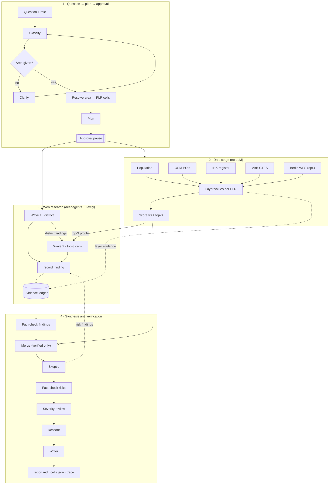

# Risalite — Deep Research Flow Spec (S1)

> **Status: draft for review, no implementation yet.** Owner: S1 (deep research team). Reviewer: please comment inline on the PR.
> Scope: everything between "user typed a question" and "result files are written". Data connectors and scoring (S2) and the frontend (S3) are owned by other people; this spec defines the contracts we need from and give to them.
> Builds on: `Risalite_Spec.md` (product, `cells.json`), `Execution_Plan.md` (streams, timeline), PR #6 (Tavily client, Nebius gateway, research budgets), the Nebius cookbook *deep-research-agent-tavily* (deepagents + `ChatNebius` + Tavily).

## 1. Summary

**Data first, web explains.** The Berlin connectors compute the numbers per PLR (Planungsraum) without any LLM. Deepagents researchers then search the web in two waves: wave 1 covers the whole district, wave 2 digs into the top-3 cells the data produced. Every claim becomes a *finding* with a verbatim quote and an evidence id in the ledger. A skeptic actively looks for counter-evidence, a deterministic fact-checker re-verifies everything, and the writer may only use verified findings.

Hard rules:

1. No LLM computes numbers. Scores are computed deterministically from layer values (S2 `build_cells`).
2. No sentence in the report without a ledger id. Citations that are not in the ledger are stripped.
3. OSM and IHK café counts are never added up; IHK is a cross-check for OSM.
4. A future development counts only if the source dates it after today. A magnitude is attached only if the source states a number.
5. Research never starts before the user approved the plan.

## 2. Decisions

| # | Topic | Decision | Status |
|---|---|---|---|
| E1 | Framework | `deepagents` (`create_deep_agent`, researcher subagents) inside a deterministic Risalite-owned run shell | confirmed |
| E2 | Researcher granularity | **Two waves**: wave 1 = up to 3 district sub-questions, started right after approval in parallel with the data stage; wave 2 = one researcher per top-3 cell, driven by the cell's data profile; wave 2 behind a flag | confirmed (C) |
| E3 | Approval | **HTTP pause before the agent** (`awaiting_approval` → `POST /runs/{id}/approve`); not deepagents `interrupt_on`. Mid-run `interrupt_on` for budget extension is a stretch | confirmed (A) |
| E4 | Skeptic | **Skeptic subagent collects counter-evidence, a structured review call judges severity** on verified risks only; fallback flag = review call only | **proposed (C), pending confirmation** |
| E5 | Fallback | Same tools and ledger in a fixed staged pipeline (u14app-style: queries → search → extract → record → fact-check → write), switchable via `RESEARCH_MODE=agent|staged` | confirmed |
| E6 | Ownership | S1 owns the complete research flow incl. ledger, fact-checker, writer, events, HTTP API. S2 owns connectors/scoring/`cells.json` builder, S3 owns the frontend | confirmed |
| E7 | Contracts | Event, ledger, finding, plan, data port as in §9; frozen after review | proposed |
| E8 | Models | Configurable per role; default routing from the bake-off in §10 | proposed |

## 3. Flow


Source (editable): [`assets/deep_research_flow.mmd`](assets/deep_research_flow.mmd)

<details><summary>Mermaid (renders on GitHub)</summary>


</details>

### 3.1 What is processed when, and who uses it next

| Step | Input | Processing | Output → used by | LLM |
|---|---|---|---|---|
| 1 Classify | free text, role | type (`point`/`location`/`gap`) + area name + why | area resolution, template | yes, structured |
| 1b Clarify | missing area | one question back, never guess | user answer → classify | no |
| 2 Resolve area | area name | `berlin_lor_names` → Bezirk/Ortsteil → PLR ids + geometry | all layers, wave 1 localization, map | no |
| 3 Plan | type, area, available snapshots | layers (only those with a snapshot), default weights + why, wave-1 sub-questions, paid slots "key not provided — skipped" | approval → data stage, wave 1 | yes, structured |
| 4 Approve | plan + user edits | validate edits against plan schema | starts 5 and 6a in parallel | no |
| 5 Data stage | S2 snapshots | layer values per PLR, normalization, score v0, OSM↔IHK cross-check | top-3 profiles → wave 2; layers → ledger; `cells.json` | no |
| 6a Wave 1 | sub-questions + PLR list | search → extract → `record_finding` | future / risk / fact findings → merge, wave 2 | yes, agent |
| 6b Wave 2 | top-3 profile + wave-1 findings | targeted neighbourhood research | confirms / contradicts data → merge | yes, agent |
| 7 Fact-check (1) | wave-1/2 findings + dataset entries | re-extract, quote ratio ≥ 0.85; recompute layers from snapshot | only `verified` → merge | no |
| 8 Merge | **verified** findings + cell values | modifiers, risks, unknowns (rules §5.4); `build_cells` | `cells.json` v1, skeptic target | no |
| 9 Skeptic | #1–#2 of v1 with evidence | counter-evidence search | risk findings → fact-check (2) | yes, agent |
| 10 Fact-check (2) | skeptic risk findings | same as (1) | verified risks → review | no |
| 11 Severity review | verified risks | severity high/medium/low with ledger ids | rescore | yes, structured |
| 12 Rescore | severities | `demoted_by` on the cell, deterministic rank rule (§5.5) | `cells.json` final, `rescore` event | no |
| 13 Writer | verified findings + final cells | summary + per-cell reasons | `report.md`, dashboard | yes, structured |

## 4. Run lifecycle and HTTP API

```text
created → classifying → (needs_clarification ↺) → planning → awaiting_approval
        → approved → researching{data, wave1, wave2} → reviewing{factcheck, merge, skeptic, factcheck_risks, review, rescore}
        → writing → done
any state → failed (error event with reason) | cancelled
```

| Endpoint | Request | Response |
|---|---|---|
| `POST /research` | `{question, role?, template_hint?}` | `{run_id, run_token, status}`; status is `needs_clarification` (with `clarify_question`) or `awaiting_approval` (with `plan`) |
| `POST /runs/{id}/clarify` | `{answer}` | same as above (re-classify with the answer) |
| `POST /runs/{id}/approve` | `{area?: {name}, subquestions?, layers?: [{id, enabled, weight}], wave2?: bool}` | `{status: "approved"}`; if `area` differs from the resolved area: re-resolve, regenerate the plan and return `{status: "awaiting_approval", plan}` (a second approve is needed); 409 if not `awaiting_approval`; 422 on schema violation (unknown layer id, weight outside 0–1, > 3 sub-questions, unresolvable area) |
| `GET /runs/{id}/events` | — | SSE stream of events (§9.1); replays from `trace.jsonl`, supports `Last-Event-ID` = `seq` |
| `GET /runs/{id}/result` | — | `{status, report_md, cells, evidence, findings, metrics}` once `done`; 202 before |

**Access:** `run_id` is a random UUID4 and is not a credential. `POST /research` also returns a random `run_token`; every `/runs/{id}/…` endpoint requires it as `Authorization: Bearer <run_token>` (SSE: `?token=` query parameter, since `EventSource` cannot set headers) and answers 404 on a missing or wrong token, so run ids neither grant access nor reveal that a run exists. The token is stored hashed in the run directory. There are no user accounts in the hackathon scope; the token binds a run to the client that created it.

`/clarify` is new compared to `Execution_Plan.md` (the clarify step needs a way back in). Runs are stored in `runs/<run_id>/`; a run is restartable from any completed stage because every stage writes its artifact before the next one starts.

## 5. Stages in detail

### 5.1 Classify, clarify, resolve area, plan

- One `NebiusGateway.plan` call each for classify and plan, with Pydantic output models (`research_outputs.py`). Each output carries a `why` that is emitted as an event.
- Area resolution is deterministic against `berlin_lor_names` (S2). Ambiguous names (e.g. "Kreuzberg" = Ortsteil vs. "Friedrichshain-Kreuzberg" = Bezirk) resolve to the smallest matching unit; the plan shows what was resolved (name, level, PLR count) so the user can correct it via `approve.area`, which re-resolves the area and regenerates the plan before research starts.
- The plan only proposes layers for which `DataPort.available_layers` returns a snapshot. Template layer catalog for T2 coffee:

| Layer id | Source (S2) | Computation per PLR | Direction | Default weight |
|---|---|---|---|---|
| `demand_density` | population + LOR area | residents / km² | + | 0.30 |
| `demand_age` | population age bands | share 18–45 | + | 0.10 |
| `competition` | OSM `coffee_shop` (primary) | cafés per 1,000 residents | − | 0.25 |
| `footfall_poi` | OSM bakery, restaurant, fast_food, coworking | POIs / km² | + | 0.15 |
| `transit` | VBB GTFS | departures 07–10 h at stops in the cell | + | 0.20 |
| `cost` (optional) | Berlin WFS (land value / MSS) | value per cell | − | 0.00 (off by default) |

IHK (`56114`, `561141`) is not a scored layer; it feeds the cross-check in 5.2. `coffee_retail` is not counted as competition.

### 5.2 Data stage (no LLM)

- Runs immediately after approval, in parallel with wave 1.
- For each approved layer: `DataPort.layer_values(area, layer_id)` → raw value per PLR + `dataset_id`, `snapshot_id`, `source_url`. Each layer becomes one ledger entry (`method: "dataset"`), so numbers are cited exactly like web pages.
- Normalization and score v0 are S2's `build_cells` (min–max within area, percentile if skewed; `score = Σ w·dir·value`, re-normalized).
- **OSM ↔ IHK cross-check** per cell: if both counts ≥ 3 and `max/min > 2`, add an unknown `"café coverage: OSM {n} vs IHK {m}"` to the cell. Threshold is a proposal for review.
- Output: `cells.json` (v0) and the **top-3 profiles**: for each top cell the layer values, ranks within the area, and the two layers that put it on top.

### 5.3 Web research (deepagents)

Orchestrator: `create_deep_agent(model=orchestrator, tools=[...], subagents=[researcher, skeptic])`. The orchestrator gets the approved plan, not the raw question only; it delegates via the deepagents `task` tool and does not search itself.

**Wave 1** (≤ 3 researchers in parallel). Default sub-questions for T2:
1. Planning and policy: Zentrenkonzept, IHK/Handelsverband, gastronomy restrictions in the district.
2. Future demand: residential and office projects dated after today (with completion dates and unit/area numbers).
3. Market: commercial rents, café openings/closures, saturation reports.

Each researcher gets the PLR list (`id`, `name`, Ortsteil) to localize findings.

**Wave 2** (one researcher per top-3 cell, starts when score v0 and wave 1 are done). Input: the cell's data profile and wave-1 findings already localized to it. The prompt asks a data-driven question, e.g. *"High transit, low competition — why? Is there a reason a café would not work here?"*. Max 3 searches per cell. `wave2=false` skips it.

**Tools** (shared by all subagents; already prototyped on the spike branch):

| Tool | Contract |
|---|---|
| `web_search(query, why, include_domains?, topic?)` | Tavily search via PR #6 client; stores every result as `WebEvidence`; returns compact JSON `[{evidence_id, title, url, snippet, published_date}]` |
| `extract_page(evidence_id, why)` | Tavily extract for a known evidence id only (the agent cannot pass arbitrary URLs); stores passage; returns the passage (truncated, wrapped as untrusted content, see below) |
| `record_finding(claim, quote, evidence_ids, claim_type, localization?, why)` | accepts only if every id exists and the quote is in the stored text (exact after whitespace normalization, or fuzzy ratio ≥ 0.85 on a bounded window); returns `{finding_id}` or an error string with the reason |

**Untrusted content.**
- *URLs:* every URL (search result, extract, fact-check re-extract) goes through the PR #6 `TavilyClient` URL policy: http(s) only, no credentials in URLs, hostname resolved and rejected if any address is private, loopback, link-local, multicast, reserved or unspecified (IPv4-mapped IPv6 included). The fetch itself is done by Tavily, not by our backend; the check also protects any later direct fetch.
- *Page text:* extracted text is data, never instructions. Tools return it inside `<untrusted_source evidence_id="…">…</untrusted_source>` with tag-like sequences escaped. The system prompts state that instructions inside sources are ignored.
- *Blast radius:* agents have no tools beyond search, extract and record, all budgeted. No secrets or file system access are in the agent context. A finding only survives if its quote is verbatim in the source. The writer never sees raw page text, only verified findings (claim + quote + ids).

`claim_type ∈ {fact, estimate, opinion, future, risk}`. `localization ∈ {plr:<id>, ortsteil:<name>, address:<text>, district}`; `address` only if the page states it.

**Budgets and stop rules** (lesson from the bake-off, §10):
- Per-researcher budget: 4 searches + 4 extracts (wave 1), 3 + 3 (wave 2, skeptic). Run-level hard cap: 40 searches.
- When a researcher's budget is exhausted the tool returns a terminal message (`BUDGET_EXHAUSTED: stop searching and return your findings`) and further calls are refused without hitting Tavily. Five consecutive tool errors end the subagent.
- Wall-clock cap per run: 6 min for research; a subagent that exceeds 120 s is cancelled and its recorded findings are kept.
- Every tool call requires `why`; it is emitted as the event's `why`.

### 5.4 Merge (deterministic)

Merge runs **after** fact-check (1) and only reads findings with `verification = verified` (for `partial`, only the matching evidence ids). Unverified claims therefore never reach modifiers, risks, unknowns or scores.

- `future` findings localized to a PLR → modifier `{type: "future", bonus: 0.10, magnitude?}` on that cell; `magnitude` only if the quote contains a number. Ortsteil-level findings apply to all PLR of that Ortsteil; district-level ones go into the report context only.
- `risk` findings → `risks[]` on the cell (severity assigned later).
- A web finding that contradicts a layer (e.g. "café scene saturated" for a low-competition cell) → `unknowns[]` with a validation suggestion.
- `score_future` is recomputed by S2 `build_cells` → `cells.json` v1. Final `cells.json` is rebuilt after rescore from verified findings only.

### 5.5 Skeptic (E4 = C, pending confirmation)

1. **Collect**: skeptic subagent with an adversarial prompt, run for #1 and #2: closures, rent jumps, saturation, construction sites, new chains, policy restrictions. Same tools, budget 3 searches per cell, findings with `claim_type="risk"`.
2. **Verify**: fact-check (2) runs on the risk findings with the same rules as fact-check (1).
3. **Judge**: one `NebiusGateway.review` call over the verified risks per cell → `[{finding_id, severity: high|medium|low, rationale}]`. Only ledger ids of verified findings are allowed; others are dropped.
4. **Rescore**: a cell with ≥ 1 verified `high` risk gets `"demoted_by": ["f_…"]` in `cells.json`; emits `rescore` with the reason. Scores stay unchanged, so the demotion is a persistent rank rule rather than a one-off reorder:
   ```text
   rank(cells):  order = sort by score desc (score_present or score_future per mode)
                 for cell in order (top to bottom, original positions):
                     if cell.demoted_by and cell is not last: swap cell with its current successor
   ```
   Each demoted cell moves down at most one place; two adjacent demoted cells keep their relative order. S2 implements `rank()` next to `build_cells`; S3 applies the same function after every layer/weight/mode change, so writer, report and dashboard always show the same ranking. The heatmap colour still uses the raw score; the top-3 list shows a "risk" badge linking to the finding.

The skeptic should use a different model family than the researchers. Fallback (`SKEPTIC_MODE=review`): skip step 1, run step 3 over existing risk findings.

### 5.6 Fact-check (deterministic)

Runs twice: (1) on all research findings and dataset entries before merge, (2) on skeptic risk findings before the severity review.

- For every finding: re-extract each cited URL (Tavily extract, cached per run), match the quote with the same matcher as `record_finding`. Status: `verified` (all ids match), `partial` (some match), `unsupported` (none).
- `unsupported` findings are excluded from writer input and listed in the report appendix "Could not verify". `partial` findings keep only the matching evidence ids.
- Dataset ledger entries are verified by recomputing the layer from the snapshot.
- Output: `factcheck.json`, `fact_check` events.
- Re-extract results are cached per URL and run, so fact-check (2) only fetches new URLs.

### 5.7 Writer

- One `NebiusGateway.synthesize` call. Input: verified findings (no raw page text), final cells (top-3 with values, modifiers, risks, unknowns), the plan. Output model: summary (3–6 sentences), per top-3 cell 2–4 reasons, risks, unknowns, each sentence with `claim_type` and `evidence_ids`.
- Post-processing: drop any sentence whose ids are not in the verified set; render `report.md` with `[n]` citations mapped to ledger ids.

## 6. T1 / T3

- **T3 (gap)** uses the same flow with a different layer catalog (supply vs. demand) and wave-2 questions about planned facilities.
- **T1 (point, S1b)** reuses ledger, tools, events and API; its hypothesis researchers replace waves 1/2 and its result is `candidates.json`. Not specified further here.

## 7. Fallback mode (E5)

`RESEARCH_MODE=staged` runs the same tools without the agent loop: per sub-question one `plan` call generates ≤ 3 queries → `web_search` → `extract_page` on the top 2 results → one `synthesize` call that must return findings in the `record_finding` shape → validated by the same function. Ledger, fact-check, skeptic review, writer and events are identical. Decision point: if the agent mode does not complete the demo question reliably (3 consecutive runs) by 16:30, switch the demo to staged.

## 8. Run directory

```text
runs/<run_id>/
  plan.json         approved plan (incl. user edits)
  evidence.jsonl    ledger: web + dataset entries
  findings.jsonl    accepted and rejected findings with reasons
  factcheck.json    status per finding
  cells.json        S2 format (Risalite_Spec.md), v0 then final
  report.md         writer output
  trace.jsonl       all events (= SSE stream)
  metrics.json      per role: model, calls, tokens in/out, seconds; searches, extracts
```

## 9. Contracts

### 9.1 Event (SSE `data:` payload, one line in `trace.jsonl`)

```json
{"run_id": "r_…", "seq": 17, "ts": "2026-10-18T14:02:11Z", "type": "search",
 "agent": "researcher:wave1:2", "why": "Need dated housing projects near Moritzplatz",
 "detail": {"query": "Wohnungsbau Moritzplatz 2027", "results": 5},
 "model": "moonshotai/Kimi-K3", "tokens_in": null, "tokens_out": null, "seconds": 1.1}
```

`type ∈ {status, classify, clarify, area, plan, approved, layer, score, search, extract, finding_accepted, finding_rejected, model_call, tool_error, budget_exhausted, merge, skeptic_risk, fact_check, review, rescore, write, metrics, error}`. `agent` is `orchestrator`, `researcher:wave1:<n>`, `researcher:wave2:<plr_id>`, `skeptic:<plr_id>`, `factcheck`, `writer`, `system`. SSE `id` = `seq`.

### 9.2 Ledger entry (`evidence.jsonl`)

Web entries are `WebEvidence` from PR #6 (`evidence_id` deterministic from canonical URL, `url`, `title`, `snippet`, `passage`, `published_date`, `retrieved_at`, `extraction_status`, `verification_status`). Dataset entries:

```json
{"evidence_id": "ds_…", "method": "dataset", "dataset_id": "berlin_population", "snapshot_id": "…",
 "layer_id": "demand_density", "source_url": "https://…", "retrieved_at": "…"}
```

### 9.3 Finding (`findings.jsonl`)

```json
{"finding_id": "f_…", "claim": "…", "quote": "…", "evidence_ids": ["ev_…"],
 "claim_type": "future", "localization": "plr:02030301", "agent": "researcher:wave2:02030301",
 "status": "accepted|rejected", "reject_reason": null, "verification": "verified|partial|unsupported|null"}
```

### 9.4 Data port (what S1 needs from S2)

```python
class AreaDataPort(Protocol):
    async def resolve_area(self, name: str) -> AreaResolution: ...          # level, PLR ids/names/Ortsteil, geometry ref
    async def available_layers(self, area: AreaResolution, template: str) -> list[LayerSpec]: ...
    async def layer_values(self, area: AreaResolution, layer_id: str) -> LayerResult: ...  # raw per PLR + dataset_id, snapshot_id, source_url
    async def cafe_cross_check(self, area: AreaResolution) -> dict[str, tuple[int, int]]: ...  # PLR -> (osm, ihk)
    def build_cells(self, area, layers, weights, modifiers, risks, unknowns) -> CellsDocument: ...
```

Backed by the existing dataset API (`GET /api/v1/datasets/{id}/records?snapshot_id&area_code&metric_code`). Until S2 delivers, S1 uses a mock port with fixtures in the same format.

### 9.5 What S3 consumes

SSE events (§9.1), `GET /runs/{id}/result`, and the files in §8. The plan object in `awaiting_approval` is the editable approval form.

## 10. Models (bake-off, 2026-10-18)

Same question ("Where is it smart to open a coffee place in Kreuzberg?"), same 3 sub-questions, same model for orchestrator and researcher, spike branch `devin/1792330015-deepagents-research`, 10-minute cap, shared 40-search budget.

| Model | Result | Seconds | Model calls | Tokens | Findings accepted / rejected | Distinct citations in report | Observations |
|---|---|---:|---:|---:|---:|---:|---|
| `moonshotai/Kimi-K3` | done | 240 | 46 | 0.81 M | 31 / 2 | 27 | clear ranking, 7 dated `future` findings, 26/31 localized, 0 tool errors |
| `deepseek-ai/DeepSeek-V4-Pro` | done | 291 | 61 | 1.52 M | 55 / 28 | 9 | most findings, but report cites few; exhausted the 40-search budget (8 tool errors); no `future` findings |
| `Qwen/Qwen3.5-397B-A17B` | done | 181 | 31 | 0.43 M | 20 / 1 | 0 | fastest, but report has **no citations**; all findings typed `fact` |
| `MiniMaxAI/MiniMax-M3` | **timeout** | > 600 | 275+ researcher calls | — | — | — | looped on the exhausted budget (491 budget errors), never finished |

Single run per model, so this is indicative, not statistically robust. The cookbook baseline (MiniMax + plain `TavilySearch`) was not reached in this run.

Proposed default routing (env `NEBIUS_MODEL_<ROLE>`):

| Role | Model | Reason |
|---|---|---|
| orchestrator, researcher | `moonshotai/Kimi-K3` | best citation discipline and future-claim handling at moderate cost |
| skeptic | `deepseek-ai/DeepSeek-V4-Pro` | different family, thorough searcher; bounded by the skeptic budget |
| classify, plan, review, writer | `moonshotai/Kimi-K3` | to be re-checked once structured calls are implemented |

Token volume (0.8–1.5 M per run) is dominated by researchers re-reading extracted pages; truncating `extract_page` output and caching per URL are the first cost levers.

## 11. Open questions for the reviewer

1. E4: confirm C (skeptic subagent + severity review) vs. A (review call only).
2. OSM↔IHK cross-check threshold (`max/min > 2`, both ≥ 3).
3. Default layer weights for T2 (§5.1) — S2 may want to own them.
4. Wave-2 trigger: top-3 by score v0 or by `score_future` after wave 1?
5. `POST /runs/{id}/clarify`, `approve.area`, `run_token` and `cells[].demoted_by` + shared `rank()` as additions to the frozen contracts (the last one needs S2 and S3 sign-off).
6. Budgets (§5.3) vs. the demo time slot.

## 12. Risks

| Risk | Mitigation |
|---|---|
| Agent loop unstable or slow on a model | per-role model config, budgets + terminal budget message, staged fallback (§7) |
| S2 data not ready | mock data port with fixtures; web-only report still possible |
| Fabricated or paraphrased quotes | `record_finding` validation + fact-check; rejected reasons fed back to the agent |
| Token cost | truncated extracts, per-run URL cache, recorded demo run |
| Demo latency | stream every step via SSE; pre-run the demo question and replay from `trace.jsonl` as backup |
